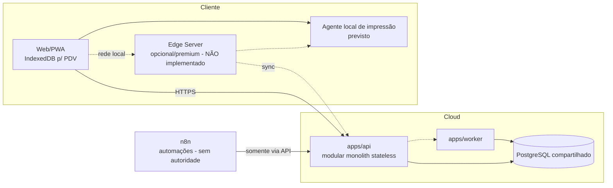
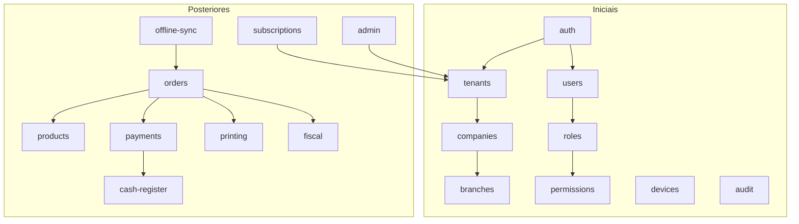

# Arquitetura

## Estilo arquitetural
- **Modular monolith**; **sem microserviços** neste momento.
- Infraestrutura compartilhada; **backend stateless**.
- PostgreSQL compartilhado; isolamento lógico por `tenant_id`.
- Sem database-per-tenant e sem schema-per-tenant.
- Preparação futura para PostgreSQL RLS (ver [security.md](security.md)).
- TypeScript strict em todo o código; preparado para múltiplas filiais.

## Stack aprovada
| Componente | Tecnologia |
|---|---|
| Frontend | Next.js + React + TypeScript |
| Backend | NestJS + TypeScript |
| Workers | Node.js + TypeScript |
| Edge Server (futuro, não implementado) | Node.js + TypeScript |
| Agente local de impressão (futuro, não implementado) | Node.js + TypeScript |

Rust **não** faz parte do planejamento atual; só poderá ser reconsiderado por decisão arquitetural explícita.

## Monorepo (npm workspaces)
| Workspace | Estado | Papel |
|---|---|---|
| `apps/web` | Next.js 16, React 19, Tailwind, Vitest, ESLint `core-web-vitals` | PWA-first (PDV e backoffice) |
| `apps/api` | NestJS 12, Prisma ORM 7.10 (CLI + client + `adapter-pg`), os 12 models do Core M1 ([database.md](database.md)), Auth/autorização runtime do M2 (`argon2`, `jose`), health endpoint, testes de boot isolados, testes de integração com PostgreSQL | Backend modular monolith |
| `apps/worker` | Node/TS mínimo, sem filas | Tarefas assíncronas |
| `packages/contracts` | vazio | Contratos compartilhados (DTOs/eventos) |
| `packages/validation` | vazio | Validação compartilhada |
| `packages/config` | vazio | Configuração compartilhada |
| `packages/ui` | vazio | Componentes de UI compartilhados |

Os packages ainda não têm responsabilidade implementada.

## Visão de contexto

Linhas tracejadas = previsto, não implementado.

## Multi-tenancy (decisão definitiva)
- `tenant_id` é obrigatório em todo dado pertencente ao cliente.
- O tenant vem do **contexto autenticado**; o frontend nunca escolhe livremente `tenant_id`.
- Constraints de banco devem reforçar o isolamento quando possível (unicidade composta com `tenant_id`, FKs compostas).
- A camada de repository/service **exige tenant context**; não deve existir acesso a dado de cliente sem ele.
- **Regra arquitetural (M2.1): toda operação de negócio em entidade tenant-scoped obtém `tenant_id` de um `TenantContext` confiável e o inclui no escopo da query.** IDs globalmente únicos (UUID) não substituem o filtro: buscar, alterar ou apagar é sempre por `tenant_id + id`. `Tenant` (raiz) e `Permission` (global) são exceções por classificação.
- RLS será segunda camada de proteção, ativada em fase posterior.

### Tenant Context e data access (M2.1)
Implementação em `apps/api/src/tenancy/`.

- **`TenantContextService`** (provido pelo `TenancyModule`, global): `run(context, fn)`, `current()`, `requireContext()`, `requireTenantId()`. O contrato mínimo é `TenantContext = { tenantId }`; campos como usuário, filial, dispositivo ou sessão só entram quando o Auth os produzir.
- **Propagação por `AsyncLocalStorage`** (`node:async_hooks`, sem dependência nova): o contexto vive na cadeia assíncrona de cada `run()` e acompanha awaits, `Promise.all`, timers e transações Prisma iniciados dentro dela; requests concorrentes não compartilham estado e não existe variável global de tenant. Um `run()` aninhado substitui o contexto só durante o callback interno e restaura o externo, inclusive em erro. Fora de `run()`, `requireTenantId()` lança `TenantContextMissingError` (sem fallback, tenant nulo, primeiro tenant ou tenant de ambiente). O `tenantId` é validado como UUID ao criar o contexto (normalizado para minúsculas) e o objeto é copiado e congelado; existência/status do tenant são verificados pelo Auth (login, refresh e AuthGuard).
- **Quem preenche o contexto (M2.7):** em requests HTTP, só o `AuthGuard` global, a partir do access token verificado e da sessão ativa no banco; o `AuthContextInterceptor` executa o handler dentro de `AuthContextService.run()`, que abre o `TenantContext` e o `AuthContext` (`{ tenantId, userId, sessionId, deviceId, mustChangePassword }`, separado para não inchar o TenantContext). Login e refresh abrem o contexto do tenant resolvido/do token só para escopar as próprias queries. Testes e infraestrutura chamam `run()` diretamente. Não há middleware, header nem parâmetro de tenant. `TenantContext` **não é autenticação** e `AsyncLocalStorage` não protege nada sozinho: só transporta o que um produtor confiável colocou. Detalhes em [security.md](security.md).
- **Classificação (`MODEL_SCOPE`, `tenant-scope.ts`):** `Tenant` = `root`, `Permission` = `global`, demais models = `tenant`; o typecheck falha se um model novo não for classificado, e um teste de integração compara com a classificação de tabelas do M1.
- **Padrão de data access: helper explícito `TenantScope`**, sem Prisma extension que reescreva queries. Repositories tenant-scoped usam `scope.where({...})` em toda leitura, update e delete e `scope.data({...})` em todo create; os dois lançam `TenantScopeViolationError` se o chamador tentar informar `tenantId`/`tenant`. Os tipos de input dos repositories não têm `tenantId` (tipos estreitos, não `Omit<Prisma...Input>`). Update/delete por chave usam `where: scope.where({ id })` (unique + `tenant_id`): registro de outro tenant = não encontrado. Para transações, o repository recebe o client da transação (`new XRepository(tx, scope)`).
- **Prova do padrão:** `CompanyRepository` (`apps/api/src/companies/`: create, findById, list, update) e `PermissionRepository` (`apps/api/src/permissions/`, global, sem contexto). Desde o M2, `DatabaseModule` fornece o `PrismaClient` (token `PRISMA_CLIENT`, `DATABASE_URL` obrigatória no boot); services constroem repositories com o client ou com o da transação (`new XRepository(prisma | tx, scope)`). Os repositories do Auth (`apps/api/src/auth/persistence/`) seguem o mesmo padrão; o único acesso sem filtro de tenant é o status do `Tenant` (`root`).
- **Prisma direto:** código de negócio acessa models tenant-scoped só via repository com `TenantScope`; uso direto de `PrismaClient`/`$queryRaw` em código de negócio exige revisão explícita e filtro por `tenant_id`. Exceções: seed, migrations, testes e infraestrutura administrativa.
- **Identidades do banco separadas:** a API e os workers usam `erp_app` (sem ownership, matriz explícita de privilégios); migrations e seed usam `erp_migrator` (dono dos objetos, só no deploy); a identidade admin só provisiona. Roles e grants são infraestrutura (`infrastructure/postgres/`), não Prisma migrations ([database.md](database.md)).

## Módulos do backend
Cada módulo vive em `apps/api/src/<modulo>` e expõe apenas uma API pública. **Nenhum módulo acessa a implementação interna de outro.** Comunicação por serviços públicos, contratos (`packages/contracts`) e eventos internos quando apropriado.

### Iniciais
| Módulo | Responsabilidade |
|---|---|
| `auth` | Autenticação e emissão do contexto autenticado (tenant, usuário, sessão, dispositivo). Implementado no M2: senha Argon2id, login, tokens, sessões, guards, troca/reset de senha, lockout. |
| `authorization` | Permissões efetivas (`AuthorizationService`) e `PermissionGuard` (M2). |
| `tenants` | Ciclo de vida do tenant (cliente SaaS). Hoje: provisionamento idempotente das roles padrão (M2.11). |
| `companies` | Empresa do tenant. |
| `branches` | Filiais da empresa. |
| `users` | Funcionários, matrícula (única por tenant), vínculo com filiais. |
| `roles` | Papéis. |
| `permissions` | Permissões e verificação de acesso. |
| `devices` | Dispositivos (PDV, agente de impressão, futuro Edge). |
| `audit` | Trilha de auditoria (não apagável fisicamente). |

### Posteriores
`products`, `orders`, `payments`, `cash-register`, `printing`, `offline-sync`, `fiscal`, `subscriptions`, `admin`.

Fronteiras detalhadas (ex.: roles x permissions; orders x payments x cash-register): **TBD**, definidas antes de cada módulo.

As setas indicam dependência permitida via API pública; não são o detalhamento final.

## IDs
**UUIDv7** é o padrão para IDs principais: geração offline, Edge, sincronização, idempotência e independência de sequência central. Gerado pelo Prisma Client (`@default(uuid(7))`) e armazenado como `uuid` no PostgreSQL (ver [database.md](database.md)).

## Workers
`apps/worker` executará tarefas assíncronas: fiscal, geração de relatórios, notificações, jobs e, no futuro, processamento via SQS. Nenhuma fila está implementada.

## n8n
Ferramenta de automação. **Não** é fonte oficial de dados, **não** decide estado de assinatura e **não** altera dados críticos sem passar pela API. Poderá automatizar avisos, billing, suporte, incidentes e integrações.

## Billing
Provedor **TBD**. A arquitetura deve prever uma abstração conceitual semelhante a `BillingProvider`, com implementações futuras possíveis (Stripe, EBANX, BTG ou outro). Nenhum fornecedor escolhido.

## Incidentes
- O ERP é a origem do chamado para o cliente.
- Ferramenta Kanban externa para a equipe; ferramenta principal decidida na implementação, Jira como segunda opção (**TBD**).
- Prioridades P1–P4; causa inicial e causa raiz; P1/P2 geram alerta ativo; incidentes globais podem agrupar vários clientes.

## Infraestrutura futura
AWS ECS/Fargate, RDS PostgreSQL, Redis, SQS, S3, Secrets Manager, CloudWatch. Nada implementado. Os scripts de `infrastructure/postgres/` são compatíveis com RDS (sem superusuário real, sem `rds_superuser` para a aplicação, sem extensão nem acesso ao sistema operacional).

## Documentos relacionados
[database](database.md) · [security](security.md) · [offline-edge](offline-edge.md) · [printing](printing.md) · [fiscal](fiscal.md) · [testing-strategy](testing-strategy.md) · [deployment](deployment.md) · [open-questions](open-questions.md)
