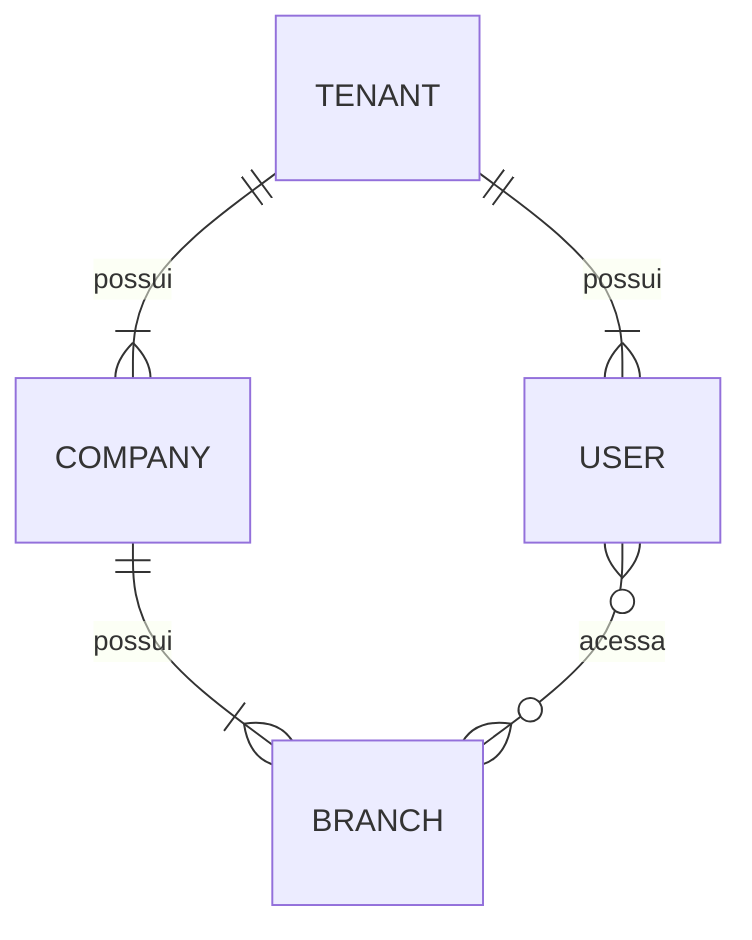

# Banco de dados

## Estado atual
PostgreSQL via Prisma. Models: `Tenant` (tabela `tenants`, migration `20261002000000_create_tenants`), `Company` (tabela `companies`, migration `20261002010000_create_companies`), `Branch` (tabela `branches`, migration `20261002020000_create_branches`), `User` (tabela `users`, migration `20261002030000_create_users`), `UserBranchAccess` (tabela `user_branch_access`, migration `20261002040000_create_user_branch_access`), `Role` (tabela `roles`, migration `20261002050000_create_roles`), `Permission` (tabela global `permissions`, migration `20261002060000_create_permissions`), `RolePermission` (tabela `role_permissions`, migration `20261002070000_create_role_permissions`), `UserRole` (tabela `user_roles`, migration `20261002080000_create_user_roles`), `Device` (tabela `devices`, migration `20261002090000_create_devices`), `Session` (tabela `sessions`, migration `20261002100000_create_sessions`) e `AuditLog` (tabela `audit_logs`, migrations `20261002110000_create_audit_logs` e `20261002111000_make_audit_logs_append_only`). A imutabilidade de `tenant_id` é imposta pela migration `20261002120000_make_tenant_id_immutable` (M1.14.1); o bloqueio de `TRUNCATE` em `audit_logs`, pela `20261002121000_forbid_audit_logs_truncate` (M1.14.2a). A URL de conexão vem de `DATABASE_URL` (lida em `apps/api/prisma.config.ts`), nunca do código. Identidades e privilégios do PostgreSQL (`erp_migrator`/`erp_app`, M1.14.2b): seção "Identidades e privilégios do PostgreSQL" abaixo.

## Tenant
Raiz do multi-tenancy; por isso **não** possui `tenant_id`.

| Coluna | Tipo PostgreSQL | Nulo | Observação |
|---|---|---|---|
| `id` | `uuid` (PK) | não | UUIDv7 gerado pelo Prisma Client |
| `name` | `text` | não | |
| `status` | enum `tenant_status` | não | `TRIAL`, `ACTIVE`, `PAST_DUE`, `SUSPENDED`, `CANCELLED`; sem default |
| `trial_started_at` | `timestamptz(3)` | sim | |
| `trial_ends_at` | `timestamptz(3)` | sim | |
| `created_at` | `timestamptz(3)` | não | default `CURRENT_TIMESTAMP` |
| `updated_at` | `timestamptz(3)` | não | mantido pelo Prisma (`@updatedAt`) |

Sem soft delete, billing, regra automática de trial ou RLS.

## Company
Empresa de um tenant. Relação **Tenant 1 → N Company**; o MVP começa com uma empresa por tenant, mas **não** há constraint 1:1.

| Coluna | Tipo PostgreSQL | Nulo | Observação |
|---|---|---|---|
| `id` | `uuid` (PK) | não | UUIDv7 gerado pelo Prisma Client (mesma estratégia do Tenant) |
| `tenant_id` | `uuid` | não | FK `tenants.id`, `ON DELETE RESTRICT ON UPDATE RESTRICT` |
| `legal_name` | `text` | não | CHECK `btrim(legal_name) <> ''` |
| `trade_name` | `text` | não | CHECK `btrim(trade_name) <> ''` |
| `cnpj` | `text` | não | somente dígitos; CHECK `cnpj ~ '^[0-9]{14}$'`; `UNIQUE (tenant_id, cnpj)` |
| `status` | enum `company_status` | não | `ACTIVE`, `INACTIVE`; sem default |
| `timezone` | `text` | não | nome IANA (ex.: `America/Sao_Paulo`); **não validado no banco** |
| `created_at` | `timestamptz(3)` | não | default `CURRENT_TIMESTAMP` |
| `updated_at` | `timestamptz(3)` | não | mantido pelo Prisma (`@updatedAt`) |

- Índices: `(tenant_id)`, `(tenant_id, status)`, a unique `(tenant_id, cnpj)` e a unique `(tenant_id, id)` (alvo da FK composta de Branch, criada na migration de Branch).
- CNPJ não é globalmente único nesta etapa; dígitos verificadores **não** são validados (nem no banco nem na aplicação).
- Os CHECKs de nome rejeitam vazio e somente espaços (`btrim` remove apenas o caractere espaço).
- Remoção física de um Tenant com Company falha (FK `RESTRICT`); sem cascade e sem soft delete.

## Branch
Filial/unidade física. Pertence a uma Company **e** ao mesmo Tenant dessa Company. Relações **Tenant 1 → N Branch** e **Company 1 → N Branch**; `tenant_id` é explícito (isolamento e performance), mesmo sendo derivável via Company.

| Coluna | Tipo PostgreSQL | Nulo | Observação |
|---|---|---|---|
| `id` | `uuid` (PK) | não | UUIDv7 gerado pelo Prisma Client |
| `tenant_id` | `uuid` | não | FK `tenants.id` (`RESTRICT`) |
| `company_id` | `uuid` | não | FK composta `(tenant_id, company_id)` → `companies(tenant_id, id)` (`RESTRICT`) |
| `name` | `text` | não | CHECK `btrim(name) <> ''` |
| `code` | `text` | não | código operacional (ex.: `MORUMBI`); CHECK `btrim(code) <> ''`; `UNIQUE (tenant_id, code)`; sem regra de formato/caixa no banco |
| `cnpj` | `text` | sim | CHECK `cnpj IS NULL OR cnpj ~ '^[0-9]{14}$'`; `UNIQUE (tenant_id, cnpj)` |
| `status` | enum `branch_status` | não | `ACTIVE`, `INACTIVE`; sem default |
| `timezone` | `text` | não | nome IANA; **não validado no banco** |
| `created_at` | `timestamptz(3)` | não | default `CURRENT_TIMESTAMP` |
| `updated_at` | `timestamptz(3)` | não | mantido pelo Prisma (`@updatedAt`) |

- Índices: `(tenant_id, company_id)` (também atende a FK composta), `(tenant_id, status)` e as uniques `(tenant_id, code)`, `(tenant_id, cnpj)` e `(tenant_id, id)` (alvo da FK composta de UserBranchAccess, criada no M1.6). Sem índice isolado em `tenant_id`: todos os compostos começam por ele.
- `code` é único por tenant (não por company): duas companies do mesmo tenant não repetem código. A unique compara o texto exato; a camada de aplicação (futura) normalizará o código com **trim + uppercase** antes de gravar, de modo que `morumbi ` e `MORUMBI` não coexistam. Nada disso é imposto no banco hoje.
- CNPJ nulo: a unique usa o padrão `NULLS DISTINCT` do PostgreSQL, logo várias branches sem CNPJ são aceitas e CNPJ preenchido não se repete no tenant. Não é globalmente único e não é comparado com o CNPJ da Company.
- Remoção física de Tenant ou Company com Branch falha (`RESTRICT`); sem cascade e sem soft delete.

### Integridade Tenant/Company (padrão para entidades filhas)
A FK simples `company_id → companies.id` não impede `branches.tenant_id` diferente de `companies.tenant_id`. Por isso:
1. `companies` tem `UNIQUE (tenant_id, id)` (redundante para unicidade, já que `id` é PK, mas necessário como alvo de FK);
2. `branches` referencia `(tenant_id, company_id) → companies(tenant_id, id)`.

O banco então rejeita, por Prisma ou SQL direto: criar Branch do Tenant A com Company do Tenant B; trocar só `company_id` ou só `tenant_id` da Branch para outro tenant; trocar `tenant_id` de uma Company que tem Branches (`ON UPDATE RESTRICT`). Os testes de integração verificam esses casos e que a versão com FK simples falharia. Entidades futuras que referenciem Company/Branch devem seguir o mesmo padrão.

## User
Funcionário individual do tenant (sem usuários compartilhados). Login futuro no PDV por **matrícula + senha**; autenticação **ainda não implementada** (nada de hashing, login, tokens ou lockout nesta etapa). Relação **Tenant 1 → N User**.

| Coluna | Tipo PostgreSQL | Nulo | Observação |
|---|---|---|---|
| `id` | `uuid` (PK) | não | UUIDv7 gerado pelo Prisma Client |
| `tenant_id` | `uuid` | não | FK `tenants.id`, `ON DELETE RESTRICT ON UPDATE RESTRICT` |
| `name` | `text` | não | CHECK `btrim(name) <> ''` |
| `employee_number` | `text` | não | matrícula; CHECK `btrim(employee_number) <> ''`; `UNIQUE (tenant_id, employee_number)`; sem formato numérico imposto |
| `password_hash` | `text` | não | **somente o hash**, gravado sem transformação; CHECK `btrim(password_hash) <> ''` |
| `status` | enum `user_status` | não | `ACTIVE`, `DISABLED` (desativação administrativa), `LOCKED` (bloqueio de segurança); sem default |
| `must_change_password` | `boolean` | não | default `false` |
| `failed_login_attempts` | `integer` | não | default `0`; CHECK `>= 0` |
| `locked_until` | `timestamptz(3)` | sim | |
| `last_login_at` | `timestamptz(3)` | sim | |
| `disabled_at` | `timestamptz(3)` | sim | |
| `created_at` | `timestamptz(3)` | não | default `CURRENT_TIMESTAMP` |
| `updated_at` | `timestamptz(3)` | não | mantido pelo Prisma (`@updatedAt`) |

- Índices: unique `(tenant_id, employee_number)`, `(tenant_id, status)` e unique `(tenant_id, id)` (alvo da FK composta de UserBranchAccess, criada no M1.6).
- **Matrícula única por tenant**, não global: a mesma matrícula pode existir em outro tenant. Comparação exata (sem normalização além de impedir vazio/espaços).
- **Senha nunca é persistida em texto puro.** Não existe coluna `password`, `plain_password`, `temporary_password` nem equivalente; a auditoria do catálogo falha se surgir coluna textual com nome de credencial além de `users.password_hash`. O algoritmo (previsão: Argon2id) pertence ao M2.
- **Sem exclusão física no fluxo normal:** o usuário é desativado (`status = DISABLED`) e permanece no histórico. Sem soft delete universal e sem cascade; Tenant com User não pode ser apagado.
- Coerência entre `status` e `disabled_at`/`locked_until` **não** é imposta no banco (ex.: reativação, bloqueio sem prazo); fica para a camada de aplicação (Auth/M2).

## UserBranchAccess
Define quais filiais um usuário pode acessar: **User 0..N Branches, sempre no mesmo Tenant**. É **separado de papel/permissão**: dizer que o usuário acessa a filial não diz o que ele pode fazer nela. Roles (inclusive por filial) serão modeladas depois. Relações Tenant/User/Branch **1 → N** UserBranchAccess.

| Coluna | Tipo PostgreSQL | Nulo | Observação |
|---|---|---|---|
| `id` | `uuid` (PK) | não | UUIDv7 gerado pelo Prisma Client |
| `tenant_id` | `uuid` | não | FK `tenants.id` (`RESTRICT`) |
| `user_id` | `uuid` | não | FK composta `(tenant_id, user_id)` → `users(tenant_id, id)` (`RESTRICT`) |
| `branch_id` | `uuid` | não | FK composta `(tenant_id, branch_id)` → `branches(tenant_id, id)` (`RESTRICT`) |
| `created_at` | `timestamptz(3)` | não | default `CURRENT_TIMESTAMP` |

- Sem `updated_at`, status, `revoked_at` ou `expires_at`: o vínculo existe ou não existe. Validade temporária será evolução explícita.
- `UNIQUE (tenant_id, user_id, branch_id)`: o mesmo acesso não é concedido duas vezes; também atende consultas por usuário e a FK composta de User. Índice `(tenant_id, branch_id)` para listar usuários de uma filial (e atender a FK composta de Branch).
- O banco rejeita, por Prisma ou SQL: User de outro tenant, Branch de outro tenant, User e Branch de tenants diferentes, e alterações posteriores de `user_id`, `branch_id` ou só `tenant_id` que criem combinação cross-tenant.
- User ou Branch com acesso não pode ser apagado (`RESTRICT`), coerente com a política de desativação; também não pode mudar de tenant (`ON UPDATE RESTRICT` nas FKs compostas).
- Um acesso usado por uma `UserRole` escopada àquela filial não pode ser removido antes dela (M1.10).
- Sem regra de "filial padrão", convite ou expiração.

## Role
Catálogo de papéis do RBAC, **pertencente ao Tenant**. Sozinha, uma Role **não concede permissão alguma**: Permission, RolePermission e UserRole ainda não existem. Relação **Tenant 1 → N Role**.

| Coluna | Tipo PostgreSQL | Nulo | Observação |
|---|---|---|---|
| `id` | `uuid` (PK) | não | UUIDv7 gerado pelo Prisma Client |
| `tenant_id` | `uuid` | não | FK `tenants.id`, `ON DELETE RESTRICT ON UPDATE RESTRICT` |
| `code` | `text` | não | identificador técnico; CHECK `btrim(code) <> ''`; `UNIQUE (tenant_id, code)`; sem uppercase imposto no banco |
| `name` | `text` | não | nome exibido; CHECK `btrim(name) <> ''` |
| `description` | `text` | sim | |
| `is_system` | `boolean` | não | default `false`; `true` = template provisionado pelo sistema, `false` = role customizada do cliente |
| `status` | enum `role_status` | não | `ACTIVE` (utilizável), `INACTIVE` (temporariamente indisponível), `ARCHIVED` (retirada de uso, mantém histórico); sem default |
| `created_at` | `timestamptz(3)` | não | default `CURRENT_TIMESTAMP` |
| `updated_at` | `timestamptz(3)` | não | mantido pelo Prisma (`@updatedAt`) |

- Índices: unique `(tenant_id, code)`, `(tenant_id, status)` e unique `(tenant_id, id)` (alvo da FK composta de RolePermission, criada no M1.9; não cria regra funcional, `id` já é PK).
- **Códigos padrão previstos** (templates, `is_system = true`): `OWNER` (Proprietário), `MANAGER` (Gerente), `ATTENDANT` (Atendente), `KITCHEN` (Cozinha). Serão criados **no provisionamento do Tenant** (futuro); **não há seed global**. O banco não reserva esses códigos: hoje uma role customizada poderia usar `OWNER` se o código ainda não existir no tenant.
- **Roles customizadas** são suportadas (`is_system = false`, código livre e único por tenant). A aplicação poderá normalizar `code` (trim + uppercase) no futuro.
- Sem regras de edição/exclusão de role de sistema ainda. Sem exclusão física como operação normal: roles são desativadas ou arquivadas; Tenant com Role não pode ser apagado (`RESTRICT`).
- Sem escopo por filial nesta etapa.

## Permission (global)
Catálogo técnico **global** de capacidades do sistema; **não pertence a um Tenant** (Role é por Tenant). Controlado pelo sistema: sem CRUD por cliente, sem permissões customizadas. A ligação Role ↔ Permission é feita por `RolePermission` (abaixo).

| Coluna | Tipo PostgreSQL | Nulo | Observação |
|---|---|---|---|
| `id` | `uuid` (PK) | não | UUIDv7 gerado pelo Prisma Client |
| `code` | `text` | não | `UNIQUE (code)` global; CHECK `code ~ '^[a-z][a-z0-9_]*(\.[a-z][a-z0-9_]*)+$'` |
| `module` | `text` | não | agrupamento funcional (texto, sem enum); CHECK `btrim(module) <> ''` |
| `description` | `text` | não | CHECK `btrim(description) <> ''` |
| `created_at` | `timestamptz(3)` | não | default `CURRENT_TIMESTAMP` |

- Sem `tenant_id`, `updated_at`, status, soft delete ou FK: só a definição técnica (nada de usuário, role, regra condicional ou escopo de filial).
- Índices: unique `(code)` e `(module)` para consultas por módulo.
- **Formato de `code`:** `<module>.<action>`, minúsculas ASCII, dígitos e `_`, dois ou mais segmentos separados por ponto, sem espaços (ex.: `branch.read`, `order.item.cancel`). O prefixo do código não precisa ser igual a `module` (ex.: `branch.read` está no módulo `organization`).
- **`code` é identificador técnico estável:** o código da aplicação dependerá dele. Renomear exige migração coordenada (vínculos e código), não uma simples edição. Não há trigger impedindo.
- **Catálogo inicial** (19 permissões, módulos `organization`, `users`, `products`, `orders`, `cash`, `fiscal`): `organization.read|manage`, `branch.read|manage`, `user.read|manage`, `role.read|manage`, `product.read|manage`, `order.read|create|cancel`, `cash.read|open|close`, `fiscal.read|issue|cancel`. Definido em `apps/api/src/database/seed/permissions.ts`.

### Seed
- `npm run db:seed` (ou `prisma db seed`): compila com `nest build` e executa `dist/database/seed.js` contra `DATABASE_URL`. Sem `tsx`. Roda no deploy como `erp_migrator` (`erp_app` só lê `permissions`).
- **Idempotente:** `upsert` por `code`; cria o que falta, realinha `module`/`description` ao catálogo e **nunca** troca o `id` (UUIDv7 gerado na primeira inserção) nem remove permissões que saíram do catálogo.

## RolePermission
Permissões concedidas a uma Role: **Role N ↔ N Permission**. **Permission é global, Role é por Tenant e RolePermission é por Tenant.** Não liga Role a User (UserRole é outro módulo). Relações Tenant/Role/Permission **1 → N** RolePermission.

| Coluna | Tipo PostgreSQL | Nulo | Observação |
|---|---|---|---|
| `id` | `uuid` (PK) | não | UUIDv7 gerado pelo Prisma Client |
| `tenant_id` | `uuid` | não | FK `tenants.id` (`RESTRICT`) |
| `role_id` | `uuid` | não | **FK composta** `(tenant_id, role_id)` → `roles(tenant_id, id)` (`RESTRICT`): a Role é sempre do mesmo tenant |
| `permission_id` | `uuid` | não | **FK simples** → `permissions(id)` (`RESTRICT`): válida porque Permission é global e compartilhada por todos os tenants |
| `created_at` | `timestamptz(3)` | não | default `CURRENT_TIMESTAMP` |

- Sem `updated_at` e sem `permission_code` duplicado: a identidade da permissão é a linha em `permissions`.
- `UNIQUE (tenant_id, role_id, permission_id)`: a mesma permissão não é atribuída duas vezes à mesma role; também lista as permissões de uma role e atende a FK composta.
- Índice `(permission_id)`: consulta inversa (quais roles, em qualquer tenant, usam a permissão; manutenção do catálogo) e checagem do `RESTRICT` ao apagar uma permissão. Escolhido em vez de `(permission_id, tenant_id)` por simplicidade: consultas por tenant partem da role, já cobertas pela unique.
- O banco rejeita, por Prisma ou SQL: Role de outro tenant; troca posterior de `role_id` para Role de outro tenant; troca só de `tenant_id`. A mesma Permission pode, naturalmente, estar em roles de vários tenants.
- **Remoção com `RESTRICT`:** Role com permissões não pode ser apagada nem mudar de tenant; **Permission vinculada não pode ser apagada** (uma permissão que sair do catálogo exigirá remover os vínculos explicitamente, política ainda não definida); Tenant com RolePermission não pode ser apagado.
- **Sem provisionamento:** a matriz de permissões das roles padrão (OWNER, MANAGER, ATTENDANT, KITCHEN) **ainda será decidida**; nenhuma permissão é atribuída automaticamente.

## UserRole
Role atribuída a um User, **global ou por filial**. Relações Tenant/User/Role **1 → N** UserRole; UserBranchAccess **1 → N** UserRole escopadas.

| Coluna | Tipo PostgreSQL | Nulo | Observação |
|---|---|---|---|
| `id` | `uuid` (PK) | não | UUIDv7 gerado pelo Prisma Client |
| `tenant_id` | `uuid` | não | FK `tenants.id` (`RESTRICT`) |
| `user_id` | `uuid` | não | FK composta `(tenant_id, user_id)` → `users(tenant_id, id)` (`RESTRICT`) |
| `role_id` | `uuid` | não | FK composta `(tenant_id, role_id)` → `roles(tenant_id, id)` (`RESTRICT`) |
| `branch_id` | `uuid` | **sim** | `NULL` = role válida em **todo o tenant**; preenchido = válida **só naquela filial**. FK composta `(tenant_id, user_id, branch_id)` → `user_branch_access(tenant_id, user_id, branch_id)` (`RESTRICT`) |
| `created_at` | `timestamptz(3)` | não | default `CURRENT_TIMESTAMP` |

- **Escopo do tenant:** `branch_id IS NULL` tem significado explícito; sem filial fictícia nem UUID sentinela, e não exige UserBranchAccess.
- **Escopo de filial exige UserBranchAccess**, garantido pelo banco: a FK para `user_branch_access` é `MATCH SIMPLE` (padrão do PostgreSQL), então é verificada quando `branch_id` está preenchido e ignorada quando é `NULL`. Como `tenant_id` e `user_id` são `NOT NULL`, só `branch_id` pode desligar essa FK (a auditoria verifica). Ela garante ao mesmo tempo que a filial existe, é do mesmo tenant e que o usuário tem acesso a ela, por isso **não há FK direta para `branches`** (seria redundante).
- **Unicidade por índices únicos parciais** (criados à mão na migration; o Prisma 7.10 não representa índices parciais e o `migrate diff` os ignora, então só os testes de catálogo os protegem):
  - `user_roles_tenant_scope_key (tenant_id, user_id, role_id) WHERE branch_id IS NULL`: impede a mesma role global duas vezes. Uma unique comum `(tenant_id, user_id, role_id, branch_id)` não bastaria, porque o PostgreSQL considera NULLs distintos;
  - `user_roles_branch_scope_key (tenant_id, user_id, role_id, branch_id) WHERE branch_id IS NOT NULL`: a mesma role uma vez por filial.
- **Global e específica podem coexistir** (ex.: MANAGER global e MANAGER na filial A). O banco não bloqueia; a autorização futura poderá tratar a global como abrangente e a específica como redundante.
- Índices não parciais: `(tenant_id, user_id, branch_id)` para listar as roles de um usuário (todas ou numa filial, `branch_id = X OR branch_id IS NULL`) e atender as FKs para `users` e `user_branch_access`; `(tenant_id, role_id)` para listar usuários de uma role e atender a FK para `roles`. Os índices parciais não servem a consultas sem filtro de escopo, por isso não substituem esses dois. Não há índice `(tenant_id, branch_id)` (listar atribuições por filial não é necessário ainda).
- **Remoção com `RESTRICT`:** User com UserRole, Role atribuída e Tenant com UserRole não podem ser apagados; o UserBranchAccess usado por uma role escopada só pode ser removido depois dela. Role global não prende nenhum acesso.
- **Para alterar uma atribuição, a aplicação deve apagar o vínculo e criar outro**, em vez de transformar o existente (trocar `role_id`/`branch_id` dentro do tenant é aceito pelo banco, mas não é o fluxo previsto).

## Device
Terminal/dispositivo conhecido pelo ERP (PDV, tablet, terminal administrativo, display de cozinha, Edge futuro). **Pertence ao Tenant**; a filial é opcional. Relações Tenant **1 → N** Device e Branch **1 → N** Device. Apenas estrutura: **sem pairing, autenticação de dispositivo, certificado, segredo ou heartbeat**.

| Coluna | Tipo PostgreSQL | Nulo | Observação |
|---|---|---|---|
| `id` | `uuid` (PK) | não | UUIDv7 gerado pelo Prisma Client |
| `tenant_id` | `uuid` | não | FK `tenants.id` (`RESTRICT`) |
| `branch_id` | `uuid` | **sim** | `NULL` = dispositivo de nível do tenant; preenchido = da filial. FK composta `(tenant_id, branch_id)` → `branches(tenant_id, id)` (`RESTRICT`) |
| `name` | `text` | não | CHECK `btrim(name) <> ''` |
| `device_type` | enum `device_type` | não | `POS`, `TABLET`, `ADMIN`, `KITCHEN_DISPLAY`, `EDGE` |
| `device_key` | `text` | não | identificador técnico estável no tenant; CHECK `btrim(device_key) <> ''`; `UNIQUE (tenant_id, device_key)` |
| `status` | enum `device_status` | não | `ACTIVE` (habilitado), `INACTIVE` (fora de uso temporário), `REVOKED` (confiança/acesso revogado); sem default |
| `last_seen_at` | `timestamptz(3)` | sim | atualização futura por heartbeat/atividade; nada o atualiza hoje |
| `created_at` | `timestamptz(3)` | não | default `CURRENT_TIMESTAMP` |
| `updated_at` | `timestamptz(3)` | não | mantido pelo Prisma (`@updatedAt`) |

- **Filial opcional:** a FK composta é `MATCH SIMPLE`, verificada quando `branch_id` está preenchido (filial existe e é do mesmo tenant) e ignorada quando é `NULL`. Sem filial sentinela.
- **`device_key` não é segredo:** é só um identificador técnico, sem geração automática. Não guarda token, senha, API key ou certificado. Segredos de dispositivo, se necessários, virão em módulo próprio e nunca em texto puro; a tabela não tem nenhuma coluna desse tipo (teste de catálogo específico + auditoria global de credenciais).
- **`EDGE` é só um tipo estrutural** nesta etapa; o Edge Server não está implementado ([offline-edge.md](offline-edge.md)).
- Índices: unique `(tenant_id, device_key)`, `(tenant_id, status)`, `(tenant_id, branch_id)` (listagem por filial e lookup da FK para `branches`; não coberto pelos outros dois) e unique `(tenant_id, id)` (alvo da FK composta de Session, criada no M1.12).
- Sem soft delete: o fluxo normal usa `INACTIVE`/`REVOKED`. Branch ou Tenant com Device não podem ser apagados; Branch com Device também não pode mudar de tenant (`ON UPDATE RESTRICT`).

## Session
Registro persistente de sessão, base para o módulo Auth (M2): sessões revogáveis, refresh tokens rotativos, encerramento administrativo. **Pertence a User e Tenant**; o Device é opcional. **Nada de login, JWT, geração/hash/rotação de token, logout, cookies ou guards nesta etapa.**

| Coluna | Tipo PostgreSQL | Nulo | Observação |
|---|---|---|---|
| `id` | `uuid` (PK) | não | UUIDv7 gerado pelo Prisma Client |
| `tenant_id` | `uuid` | não | FK `tenants.id` (`RESTRICT`) |
| `user_id` | `uuid` | não | FK composta `(tenant_id, user_id)` → `users(tenant_id, id)` (`RESTRICT`) |
| `device_id` | `uuid` | **sim** | sessão com ou sem dispositivo conhecido; FK composta `(tenant_id, device_id)` → `devices(tenant_id, id)` (`RESTRICT`, `MATCH SIMPLE`: verificada só quando preenchido, sempre do mesmo tenant) |
| `refresh_token_hash` | `text` | não | **somente o hash** do refresh token atual; `UNIQUE` **global**; CHECK `btrim(refresh_token_hash) <> ''` |
| `ip_address` | `inet` | sim | tipo nativo do PostgreSQL (`String @db.Inet` no Prisma 7.10, sem `Unsupported`); o banco rejeita IP inválido |
| `user_agent` | `text` | sim | só metadado de contexto, nunca identificador de segurança; sem índice |
| `expires_at` | `timestamptz(3)` | não | **sem default**: quem cria a sessão informa a expiração; CHECK `expires_at > created_at` |
| `revoked_at` | `timestamptz(3)` | sim | `NULL` = não revogada |
| `created_at` | `timestamptz(3)` | não | default `CURRENT_TIMESTAMP` |

- **Estado derivado**, sem enum de status, `is_revoked` ou `updated_at`: ativa = `revoked_at IS NULL AND expires_at > now()`; revogada = `revoked_at IS NOT NULL`; expirada = `expires_at <= now()`. Revogação pode ocorrer antes ou depois da expiração (sem constraint entre as duas).
- **`refresh_token_hash` é globalmente único** (sem `tenant_id`): dois registros nunca compartilham token, a autenticação futura localiza a sessão direto pelo hash e um token rotacionado não identifica duas sessões. O token será aleatório o bastante (M2) para não depender de escopo por tenant.
- **Nunca persistir refresh token puro nem access token.** Não existem colunas `refresh_token`, `token` ou `access_token`; a auditoria de credenciais as rejeita.
- **CHECK `expires_at > created_at`**: compara valores da própria linha (com o default, `created_at` é o início da transação), então não depende de ordem de avaliação. Fixtures de sessões já expiradas precisam informar também um `created_at` anterior.
- Índices: unique `(refresh_token_hash)`, `(tenant_id, user_id)` (sessões do usuário e FK para `users`) e `(tenant_id, device_id)` (sessões do dispositivo e FK para `devices`). Sem índice em `expires_at` por enquanto.
- **Rotação (M2):** a sessão guarda apenas o hash do refresh token válido; na rotação o hash será substituído transacionalmente. Histórico de tokens, token family, hash anterior ou detecção de reuso/replay **não** foram antecipados.
- **Remoção com `RESTRICT`:** User, Device e Tenant com sessão não são apagados; User ou Device com sessão também não mudam de tenant. Retenção/LGPD das sessões históricas ainda será definida.

## AuditLog
Trilha histórica **append-only** de eventos relevantes do tenant: segurança, administração, operação, alterações sensíveis, ações de usuário, de dispositivo e automáticas do sistema. **Pertence ao Tenant**; usuário, filial e dispositivo são opcionais. Apenas a estrutura persistente: **nenhum controller, service ou worker grava eventos ainda** (instrumentação e `AuditService` são etapas futuras).

| Coluna | Tipo PostgreSQL | Nulo | Observação |
|---|---|---|---|
| `id` | `uuid` (PK) | não | UUIDv7 gerado pelo Prisma Client |
| `tenant_id` | `uuid` | não | FK `tenants.id` (`RESTRICT`) |
| `user_id` | `uuid` | **sim** | ator humano, quando houver. FK composta `(tenant_id, user_id)` → `users(tenant_id, id)` (`RESTRICT`, `MATCH SIMPLE`) |
| `branch_id` | `uuid` | **sim** | filial do evento, quando houver. FK composta `(tenant_id, branch_id)` → `branches(tenant_id, id)` (`RESTRICT`, `MATCH SIMPLE`) |
| `device_id` | `uuid` | **sim** | dispositivo de origem, quando houver. FK composta `(tenant_id, device_id)` → `devices(tenant_id, id)` (`RESTRICT`, `MATCH SIMPLE`) |
| `action` | `text` | não | ação técnica (sem enum); CHECK `action ~ '^[a-z][a-z0-9_]*(\.[a-z][a-z0-9_]*)+$'` |
| `resource_type` | `text` | não | tipo lógico do recurso afetado (sem enum); CHECK `resource_type ~ '^[a-z][a-z0-9_]*$'` |
| `resource_id` | `uuid` | sim | referência **lógica/polimórfica**, **sem FK** (abaixo) |
| `metadata` | `jsonb` | sim | contexto adicional; **nunca** credenciais (abaixo) |
| `ip_address` | `inet` | sim | mesmo padrão de `sessions.ip_address` (`String @db.Inet`); o banco rejeita IP inválido |
| `created_at` | `timestamptz(3)` | não | default `CURRENT_TIMESTAMP` |

- **Append-only, imposto pelo PostgreSQL** (migrations `20261002111000_make_audit_logs_append_only` e `20261002121000_forbid_audit_logs_truncate`): sem `updated_at`, `deleted_at`, status ou soft delete, e **`UPDATE`, `DELETE` e `TRUNCATE` são bloqueados fisicamente**. `INSERT` continua livre.
  - Função `forbid_audit_log_mutation()` (`plpgsql`, `RETURNS trigger`): sempre lança `AuditLog is append-only: <TG_OP> on audit_logs is not allowed` (SQLSTATE `P0001`, com `HINT`), com `TG_OP` = `UPDATE`, `DELETE` ou `TRUNCATE`. Reutilizada **sem alteração** pelo trigger de TRUNCATE: como nunca retorna normalmente e já informa a operação, serve a row e statement triggers.
  - Trigger `audit_logs_append_only`: `BEFORE UPDATE OR DELETE ON audit_logs FOR EACH ROW`. Rejeita qualquer UPDATE (inclusive no-op `SET x = x` e em massa) e qualquer DELETE, via Prisma ou SQL; a transação que tenta falha e a linha fica intacta.
  - Trigger `audit_logs_no_truncate`: `BEFORE TRUNCATE ON audit_logs FOR EACH STATEMENT` (row triggers não disparam em TRUNCATE). Rejeita `TRUNCATE`, `TRUNCATE TABLE`, `ONLY`, `RESTART`/`CONTINUE IDENTITY`, `CASCADE`/`RESTRICT` e também o TRUNCATE em cascata a partir de uma tabela pai (ex.: `TRUNCATE tenants CASCADE`, que alcançaria `audit_logs` pela FK); a tabela fica intacta e a transação é desfeita.
  - **Específicos de `audit_logs`:** a função não deve ser reutilizada em outra tabela (a auditoria do catálogo exige que ela só apareça em `audit_logs`, e exatamente nos dois triggers aprovados). **Não é** o trigger genérico de imutabilidade de `tenant_id` (M1.14.1): aquele bloqueia só a troca de `tenant_id` em tabelas que continuam editáveis; este bloqueia toda mutação de uma tabela que não é editável, e por isso `audit_logs` não recebe o genérico.
  - Como o BEFORE trigger dispara antes das FKs, um UPDATE em `audit_logs` falha pelo append-only, nunca pela FK. As FKs compostas continuam sendo a segunda barreira: testes desabilitam o trigger dentro de uma transação desfeita e provam que vínculos cross-tenant ainda são rejeitados.
  - **Fronteira desta proteção:** vale para operações normais com triggers ativos. Desde o M1.14.2b a aplicação roda como `erp_app`, que não tem `UPDATE`/`DELETE`/`TRUNCATE` em `audit_logs` (segunda camada, independente dos triggers), não é dona da tabela nem das funções e não consegue desabilitar triggers, alterar funções, executar DDL ou `SET session_replication_role`. O dono (`erp_migrator`, só no pipeline de deploy) e a identidade admin continuam capazes disso; ver "Identidades e privilégios do PostgreSQL".
- **Ator e contexto opcionais, sem sentinela:** `user_id NULL` = evento sem usuário (worker, rotina automática, evento sistêmico, evento só de dispositivo); não existe usuário fictício `SYSTEM`. `branch_id`/`device_id` `NULL` = sem filial/dispositivo. As três FKs compostas são `MATCH SIMPLE` (padrão do PostgreSQL): verificadas quando a coluna está preenchida e ignoradas quando é `NULL`; preenchidas, garantem existência e mesmo tenant. Não há regra entre elas (ex.: o banco não exige que o dispositivo seja da filial informada).
- **`action`** (ex.: `user.created`, `role.assigned`, `session.revoked`, `order.item.cancelled`): mesmo formato de `permissions.code`: minúsculas ASCII, dígitos e `_`, dois ou mais segmentos separados por ponto, cada um começando por letra. Rejeita maiúsculas, espaços, ponto inicial/final, segmento vazio e segmento único. `$` no regex do PostgreSQL casa só no fim do texto, então um `\n` final também é rejeitado. **Sem catálogo de ações no banco** (nem enum, nem tabela).
- **`resource_type`** (ex.: `user`, `role`, `device`, `session`, `order`, `payment`, `fiscal_document`): um único segmento, minúsculas, dígitos e `_`, começando por letra.
- **`resource_id` sem FK, de propósito:** (1) o recurso pode ser de qualquer tipo, atual ou futuro; (2) o log precisa sobreviver ao ciclo de vida do recurso (ex.: um vínculo apagado continua auditável); (3) o PostgreSQL não tem FK polimórfica, e as alternativas (uma coluna/FK por tipo, tabela de supertipo, triggers genéricos) foram descartadas. Consequências: o banco não garante que o recurso existe nem que é do mesmo tenant; `resource_type` + `resource_id` são uma referência informativa, e a camada de aplicação é responsável por gravá-los corretamente. Tipo `uuid` porque todos os IDs do sistema são UUIDv7; recurso sem UUID fica com `resource_id NULL` e identificação em `metadata`.
- **`metadata` não é local permitido para credenciais.** Nunca gravar conscientemente: senha, `password_hash`, refresh token, `refresh_token_hash`, access token, API key, segredo, chave privada, PIN, dados completos de cartão. Nesta etapa **não há sanitizador automático** de JSON nem CHECK de conteúdo; a futura camada `AuditService` deverá filtrar/mascarar antes de gravar. A auditoria de credenciais do catálogo verifica só **nomes de colunas** (`metadata` não casa), não o conteúdo do JSON. Também não há restrição de forma (objeto, array ou escalar são aceitos) nem de tamanho. `NULL` SQL e `null` JSON são distintos: no Prisma, omitir o campo ou usar `Prisma.DbNull` grava `NULL` SQL.
- **Índices** (todos começam por `tenant_id`; `created_at` no fim para ordenar a linha do tempo):
  - `(tenant_id, created_at)`: linha do tempo do tenant;
  - `(tenant_id, user_id, created_at)`, `(tenant_id, branch_id, created_at)`, `(tenant_id, device_id, created_at)`: ações por usuário, filial e dispositivo; também atendem a checagem `RESTRICT` das FKs compostas;
  - `(tenant_id, resource_type, resource_id, created_at)`: histórico de um recurso.
  - Sem índice em `action` ou GIN em `metadata` por enquanto. É uma tabela de escrita intensa: cada índice novo deve ser justificado por consulta real.
- **Remoção com `RESTRICT`:** User, Branch, Device e Tenant referenciados por um log não podem ser apagados (coerente com a política de desativação e com "auditoria nunca é apagada fisicamente"); também não mudam de tenant (`ON UPDATE RESTRICT`).
- Retenção, particionamento, arquivamento e LGPD de `ip_address`/`metadata` ainda serão definidos.

## Identidades e privilégios do PostgreSQL (M1.14.2b)
Duas identidades, criadas fora das Prisma migrations por scripts de infraestrutura em [`infrastructure/postgres/`](../infrastructure/postgres/README.md) (sem senha no git):

| Identidade | Uso | Dona dos objetos | Atributos |
|---|---|---|---|
| admin/bootstrap (superusuário self-hosted ou master do RDS) | só provisionamento (`01`, `02`) | o database | — |
| `erp_migrator` | `prisma migrate deploy`, `db:seed`, `03-runtime-grants.sql` | **sim**: tabelas, enums, funções (triggers pertencem às tabelas) | `LOGIN NOSUPERUSER NOCREATEDB NOCREATEROLE NOREPLICATION NOBYPASSRLS`, sem memberships; `USAGE, CREATE` só em `public` |
| `erp_app` | API NestJS e workers | **nunca** | idem; sem memberships (não é membro de `erp_migrator`, não faz `SET ROLE`); só `USAGE` em `public` |

**Ordem:** (1) admin: `01-bootstrap-roles.sql` (cluster); (2) credenciais de login provisionadas fora do git; (3) admin, no banco do ERP: `02-bootstrap-database.sql`; (4) `erp_migrator`: `prisma migrate deploy` (e seed); (5) `erp_migrator`: `03-runtime-grants.sql`, a cada deploy; (6) a aplicação conecta como `erp_app`. A `DATABASE_URL` da aplicação/workers é sempre `erp_app`; a de migration/seed é `erp_migrator`; a identidade admin nunca é usada por eles.

**Matriz runtime de `erp_app`** (`03-runtime-grants.sql`, espelhada em `RUNTIME_TABLE_PRIVILEGES`; sem `GRANT ALL`):

| Tabela | `erp_app` | Observação |
|---|---|---|
| `tenants`, `companies`, `branches`, `users`, `roles`, `devices`, `sessions` | `SELECT`, `INSERT`, `UPDATE` | entidades mutáveis; sem `DELETE` (desativação por status) e sem `TRUNCATE` |
| `user_branch_access`, `role_permissions`, `user_roles` | `SELECT`, `INSERT`, `DELETE` | vínculos: delete + create; sem `UPDATE` e sem `TRUNCATE` |
| `permissions` | `SELECT` | catálogo global; escrita só pelo deploy (seed como `erp_migrator`) |
| `audit_logs` | `SELECT`, `INSERT` | append-only também por privilégio; sem `UPDATE`/`DELETE`/`TRUNCATE` |
| `_prisma_migrations` | nenhum | ferramenta de migration |

Nenhuma tabela tem `REFERENCES` ou `TRIGGER` para `erp_app`; nenhuma tem grant por coluna; `PUBLIC` não tem privilégio em tabela alguma.

- **Schema `public`:** `PUBLIC` sem `CREATE` (explícito, também para servidores < 15); `erp_migrator` com `USAGE, CREATE`; `erp_app` só `USAGE`. Nenhuma das duas tem `CREATE` no database (não criam schemas). `CONNECT` explícito para as duas.
- **Funções:** `forbid_audit_log_mutation()` e `forbid_tenant_id_change()` sem `EXECUTE` para `PUBLIC` nem `erp_app` (só o dono). Triggers continuam disparando: o PostgreSQL não exige `EXECUTE` de quem dispara. `ALTER DEFAULT PRIVILEGES FOR ROLE erp_migrator REVOKE EXECUTE ON FUNCTIONS FROM PUBLIC`: funções futuras nascem sem `EXECUTE` público; acesso de `erp_app` a uma função futura é concedido explicitamente.
- **Tabelas futuras:** sem default privileges de tabela. Uma tabela nova nasce sem nenhum privilégio runtime; o módulo declara sua política em `03-runtime-grants.sql` e em `RUNTIME_TABLE_PRIVILEGES`, senão a auditoria falha (fail-closed).
- **`03-runtime-grants.sql` é idempotente e fail-closed:** revoga tudo de `PUBLIC`/`erp_app` (tabelas e funções, inclusive grants por coluna) e reaplica a matriz, numa transação. O que não está no arquivo não existe.
- **Duas camadas em `audit_logs`:** privilégios (`erp_app` só `SELECT, INSERT`) e triggers append-only (valem para qualquer identidade com privilégio de escrita, inclusive o dono). Em `tenant_id`, o trigger de imutabilidade vale também para `erp_app`, que tem `UPDATE` nas entidades.
- **Testes:** o setup de integração executa os mesmos três scripts com roles únicas por execução (`erp_migrator_t<hex>`, `erp_app_t<hex>`) e senhas aleatórias em memória; migrations rodam como migrator; os testes de schema usam o migrator; `app-role.int.test.ts` conecta **de fato** como `erp_app`. Banco e roles são removidos ao final.
- **Auditoria fail-closed** (`runtime-privileges.int.test.ts` + `table-audit.ts`): `runtimePrivilegeViolations` compara o privilégio efetivo de `erp_app` (tabela, coluna, via `PUBLIC` ou membership) com `RUNTIME_TABLE_PRIVILEGES` para toda tabela de `public` (tabela sem política falha) e acusa privilégio em sequence; `ownershipViolations` exige `erp_migrator` como dono de toda relação, função e tipo de `public` e nenhum objeto do banco pertencente a `erp_app`; `privilegeModelViolations` verifica atributos e memberships das duas roles, `CREATE`/`USAGE` em `public`, `CREATE` no database, `EXECUTE` de funções (inclusive `PUBLIC` e ACL nula) e default privileges. Sondas (transação desfeita, como migrator ou admin) provam a detecção de cada desvio.
- **Fora do escopo/limites:** o dono (`erp_migrator`) e a identidade admin podem desabilitar triggers, alterar funções e executar DDL; a proteção é restringir essas credenciais ao pipeline/provisionamento. `PUBLIC` mantém o `TEMPORARY` padrão no database (objetos temporários de sessão, fora de `public`). Mecanismo de login em produção (senha via Secrets Manager ou IAM database authentication) **TBD**.

## Integridade organizacional (M1.4)
Regras: relações cross-tenant devem ser **bloqueadas no banco** sempre que possível, não só na aplicação; nenhuma FK organizacional usa `CASCADE`, `SET NULL` ou `SET DEFAULT` (apenas `RESTRICT`).

### `tenant_id` imutável (decisão fechada, imposta no banco — M1.14.1)
**`tenant_id` é imutável no banco para toda entidade editável pertencente a tenant.** Depois de criada, uma linha nunca muda de tenant: nem via Prisma, nem via SQL direto, nem quando todas as FKs são alteradas juntas de forma consistente. A regra não depende da aplicação.

**Mecanismo** (migration `20261002120000_make_tenant_id_immutable`):
- Função compartilhada `forbid_tenant_id_change()` (`plpgsql`, `RETURNS trigger`, sem argumentos). Não conhece nomes de tabela: usa `TG_TABLE_SCHEMA`/`TG_TABLE_NAME` na mensagem. Lança SQLSTATE **`23000`** (`integrity_constraint_violation`) com `COLUMN = 'tenant_id'`, `TABLE`, `SCHEMA` e `HINT`; mensagem `tenant_id is immutable: UPDATE on public.<tabela> cannot change tenant_id`. Rechecagem defensiva interna (`NEW.tenant_id IS DISTINCT FROM OLD.tenant_id`): continua correta mesmo se um trigger for criado sem o `WHEN`.
- Um trigger por tabela, `<tabela>_tenant_id_immutable`: `BEFORE UPDATE OF tenant_id ... FOR EACH ROW WHEN (OLD.tenant_id IS DISTINCT FROM NEW.tenant_id) EXECUTE FUNCTION forbid_tenant_id_change()`.
- Tabelas protegidas: `companies`, `branches`, `users`, `user_branch_access`, `roles`, `role_permissions`, `user_roles`, `devices`, `sessions`.
- **Fora do trigger genérico:** `audit_logs` (política própria: append-only, UPDATE/DELETE/TRUNCATE bloqueados); `tenants` (raiz, sem `tenant_id`); `permissions` (global, sem `tenant_id`); `_prisma_migrations`.

**O que continua permitido:** qualquer UPDATE que não mude o valor de `tenant_id` (`trade_name`, `name`, `revoked_at`...); `SET tenant_id = tenant_id` ou o mesmo UUID (o `WHEN` só dispara com mudança real); Prisma `update` repetindo o `tenantId` atual ou `connect` no mesmo tenant.

**O que é bloqueado** (testado): UPDATE direto, em massa, com `UPDATE ... FROM`, subconsulta, CTE `WITH ... UPDATE ... RETURNING`, junto de outras colunas, `INSERT ... ON CONFLICT DO UPDATE`, `MERGE`; no Prisma, `update`, `updateMany`, `upsert`, `connect` de outro tenant e `$transaction` (a transação inteira é desfeita). Bloqueia também `tenant_id` para tenant inexistente (o trigger dispara antes da FK).

**Ordem das barreiras:** o trigger BEFORE dispara antes das checagens de FK. Um UPDATE de `tenant_id` falha sempre pela imutabilidade (`23000`), nunca pela FK. As FKs compostas continuam existindo e sendo verificadas pelo catálogo, e seguem bloqueando trocas de `company_id`/`user_id`/`branch_id`/`role_id`/`device_id` para outro tenant (essas não mexem em `tenant_id`, então não passam pelo trigger).

| Alteração | Resultado | Mecanismo |
|---|---|---|
| `tenant_id` de qualquer linha de tabela editável de tenant (sozinho ou com FKs, consistente ou não, tenant existente ou não) | bloqueada | trigger `<tabela>_tenant_id_immutable` |
| `tenant_id` para o mesmo valor | aceita | `WHEN` não dispara |
| Branch: só `company_id` para Company de outro tenant | bloqueada | FK composta `branches_tenant_id_company_id_fkey` |
| UserBranchAccess: `user_id` ou `branch_id` de outro tenant | bloqueada | FKs compostas |
| RolePermission: `role_id` de outro tenant | bloqueada | FK composta |
| UserRole: `user_id`, `role_id` ou `branch_id` de outro tenant (ou filial sem acesso) | bloqueada | FKs compostas |
| Device: `branch_id` para filial de outro tenant | bloqueada | FK composta `devices_tenant_id_branch_id_fkey` |
| Session: `user_id`/`device_id` de outro tenant | bloqueada | FKs compostas de `sessions` |
| AuditLog: qualquer alteração, inclusive `tenant_id`; DELETE; TRUNCATE | bloqueada | triggers `audit_logs_append_only` e `audit_logs_no_truncate` |

**Novas tabelas de tenant** precisam do trigger `<tabela>_tenant_id_immutable` na própria migration de criação; a auditoria do catálogo falha sem ele (abaixo). Uma tabela de tenant só fica sem o trigger genérico se for declarada em `SPECIAL_TENANT_ID_POLICIES` com política verificável (hoje só `audit_logs`, append-only).

**Limites:** o trigger é `UPDATE OF tenant_id`, ou seja, só dispara quando `tenant_id` está no `SET` (ou no `UPDATE SET` de `ON CONFLICT`/`MERGE`). Um futuro trigger BEFORE que altere `NEW.tenant_id` sem que a coluna esteja no `SET` não seria pego; não existe nenhum hoje, e o inventário fail-closed de triggers exige revisão para qualquer trigger novo. A identidade runtime (`erp_app`) não consegue desabilitar, remover ou recriar triggers e funções; o dono (`erp_migrator`) e a identidade admin conseguem (M1.14.2b).

### Auditoria automatizada do catálogo
`org-integrity.int.test.ts` (com `test/integration/table-audit.ts`) classifica **toda** tabela de `public` em: raiz (`tenants`), ferramenta do Prisma (`_prisma_migrations`), **global explicitamente declarada** (`GLOBAL_TABLES`, hoje só `permissions`) ou tabela de tenant (todo o resto). É fail-closed: uma tabela nova sem `tenant_id` só passa se for adicionada à lista de globais, decisão explícita e revisada; tabelas globais não podem ter `tenant_id` nem FK para `tenants`. Testes-sonda criam tabelas inválidas numa transação desfeita e provam que a auditoria as reporta. Falha também se: alguma tabela de tenant não tiver `tenant_id uuid NOT NULL`; faltar a FK direta `tenant_id → tenants(id)`; alguma FK usar `CASCADE`/`SET NULL`/`SET DEFAULT`; uma FK violar a regra por classificação do alvo (abaixo); o conjunto de FKs mudar; ou existir coluna textual com nome de credencial (`password`, `pwd`, `senha`, `secret`, `pin`, `credential`, `token`, `api_key`, `private_key`) fora da allowlist explícita de hashes `HASHED_CREDENTIAL_COLUMNS` (`users.password_hash`, `sessions.refresh_token_hash`). A verificação é por nome de coluna (inclusive `json`/`jsonb`); o conteúdo de `audit_logs.metadata` não é inspecionado. A allowlist é por `tabela.coluna`: `refresh_token_hash` em outra tabela também é reportado; flags como `must_change_password` não contam (só colunas textuais). Tabelas novas entram na auditoria automaticamente.

**Imutabilidade de `tenant_id` na auditoria** (`tenantIdImmutabilityViolations`, M1.14.1): a lista de tabelas protegidas **é derivada da classificação** (toda tabela de tenant), não de uma lista manual. Para cada uma, exige exatamente um trigger que chame `forbid_tenant_id_change()`, chamado `<tabela>_tenant_id_immutable`, `BEFORE`, `FOR EACH ROW`, só `UPDATE`, `UPDATE OF tenant_id`, habilitado (`tgenabled = 'O'`) e com definição idêntica à aprovada (`pg_get_triggerdef`, inclusive o `WHEN`). Exceção **explícita e verificada**: `SPECIAL_TENANT_ID_POLICIES` (hoje só `audit_logs` → append-only). A política declara a função e os triggers exigidos: `audit_logs_append_only` (`BEFORE UPDATE OR DELETE`, por linha) e `audit_logs_no_truncate` (`BEFORE TRUNCATE`, por statement), ambos habilitados, sem `INSERT` e chamando `forbid_audit_log_mutation()`. A auditoria exige que a política declarada bloqueie todos os eventos de `APPEND_ONLY_BLOCKED_EVENTS` (`UPDATE`, `DELETE`, `TRUNCATE`) — tabela parcialmente protegida é violação —, que cada trigger exigido exista exatamente como declarado e que **nenhum outro trigger** exista na tabela (inclusive o genérico de `tenant_id`). Também falha se `forbid_tenant_id_change()` for usada em tabela não-tenant ou `forbid_audit_log_mutation()` fora de `audit_logs`. Sondas (transação desfeita) provam a detecção de: tabela sem trigger, trigger `AFTER`, por statement, sem `OF tenant_id`, sem `WHEN`, também em `DELETE`, desabilitado, com outro nome, política append-only desabilitada/ausente, guarda de TRUNCATE ausente/desabilitada/`AFTER`/com outra função/também em `INSERT`, trigger extra na tabela append-only, política declarada sem `TRUNCATE` e uso das funções na tabela errada.

**FKs são julgadas pela classificação das tabelas, não pelas colunas atuais** (`foreignKeyViolations`):
- tenant → `tenants`: exatamente `(tenant_id) → tenants(id)`;
- tenant → tenant: `tenant_id` nos dois lados (FK composta);
- tenant → **global declarada**: FK simples permitida (ex.: `role_permissions.permission_id → permissions.id`);
- global/raiz/ferramenta → tenant ou raiz: proibido; qualquer FK → `_prisma_migrations`: proibido.

Não há exceção genérica: uma FK simples só é aceita se o alvo estiver em `GLOBAL_TABLES`. Sondas provam que FK simples tenant → tenant é rejeitada, tenant → global declarada é aceita, a mesma FK para uma tabela não declarada é rejeitada e uma tabela global não pode apontar para dado de tenant. Toda FK composta precisa ter `tenant_id` `NOT NULL` (com `MATCH SIMPLE`, um `tenant_id` nulo desligaria a verificação); as únicas FKs compostas com coluna anulável são os vínculos opcionais declarados explicitamente no teste: `branch_id` de `user_roles` e de `devices`, `device_id` de `sessions`, e `user_id`, `branch_id` e `device_id` de `audit_logs`.

### Validações que ficam fora do banco
- **CNPJ completo** (dígitos verificadores; raiz do CNPJ da Branch x Company): responsabilidade futura de `packages/validation`. O banco garante só o formato (14 dígitos) e a unicidade por tenant.
- **Timezone IANA** (Company e Branch): validado na camada de aplicação; o banco guarda texto obrigatório, sem lista própria.
- **Branch.code**: normalização trim + uppercase na aplicação.

## CHECK constraints, índices parciais, funções e triggers
O schema Prisma não representa CHECKs nem índices únicos parciais (`user_roles`): eles são escritos à mão na migration. Consequências:
- `prisma migrate diff`/`migrate dev` **não** os geram nem os removem, e o teste de drift **não** os detecta; por isso o teste de migration verifica cada CHECK explicitamente.
- O mesmo vale para **funções e triggers** (hoje `forbid_audit_log_mutation()` + `audit_logs_append_only` + `audit_logs_no_truncate` e `forbid_tenant_id_change()` + os 9 `<tabela>_tenant_id_immutable`): confirmado nas checagens negativas do M1.13.1, M1.14.1 e M1.14.2a que o teste de drift passa mesmo sem o trigger. Por isso há testes de catálogo obrigatórios: inventário fail-closed explícito de funções de `public` e de triggers não internos (`migration.int.test.ts`), a auditoria de imutabilidade de `tenant_id` (`org-integrity.int.test.ts`) e, em `audit-log.int.test.ts`, existência, tabela, eventos, `BEFORE`, nível (linha para UPDATE/DELETE, statement para TRUNCATE), habilitação (`tgenabled = 'O'`), definição exata e ausência de outros triggers em `audit_logs`. Trigger ou função nova exige atualizar o inventário.
- Ao recriar ou alterar a tabela em migration futura, os CHECKs precisam ser mantidos manualmente.
- O schema registra em comentário quais CHECKs existem em cada model.

## Versão do Prisma
- O projeto iniciou com **Prisma ORM 7** (CLI fixado em `~7.10.0` em `apps/api`).
- Upgrades de major (ex.: Prisma 8) são **tarefas explícitas e dedicadas**.
- Nunca atualizar a major do Prisma automaticamente como parte de outra feature.
- `@prisma/client` e `@prisma/adapter-pg` fixados em `~7.10.0`, mesma versão do CLI. No Prisma 7 o client exige driver adapter.
- Client gerado (`prisma-client`, ESM) em `apps/api/src/generated/prisma`, fora do git; `build`, `typecheck` e `test:integration` executam `prisma generate`.
- `PrismaClient` é criado **somente** por `createPrismaClient` (`apps/api/src/database/create-prisma-client.ts`), ver "Fuso da sessão". O ESLint (`npm run lint`) bloqueia `new PrismaClient(...)` e o import de valor de `PrismaClient` em qualquer outro arquivo (import apenas de tipo é permitido).

## Multi-tenancy
- PostgreSQL compartilhado; isolamento lógico por `tenant_id`.
- `tenant_id` obrigatório em toda tabela com dado pertencente ao cliente.
- Constraints devem reforçar o isolamento quando possível: unicidade composta (ex.: matrícula única por `(tenant_id, matricula)`), FKs que incluam `tenant_id`, índices iniciados por `tenant_id`.
- Esquema compatível com RLS; RLS será ativada em fase posterior ([security.md](security.md)).
- Proibido: database-per-tenant e schema-per-tenant.

## Convenções
| Tema | Decisão |
|---|---|
| IDs | UUIDv7 para IDs principais (offline, Edge, sync, idempotência). Gerado pelo Prisma Client via `@default(uuid(7))`, coluna `@db.Uuid` (tipo `uuid`). Sem default no banco: inserts fora do Prisma (SQL bruto, outras ferramentas) precisam informar o `id`. |
| Dinheiro | `numeric`, nunca float. Precisão/escala: **TBD**. |
| Tempo | `timestamptz(3)` (precisão de ms, igual ao `Date` do JS), armazenado em UTC. |
| Remoção | **Sem soft delete universal.** Estratégia por entidade: **TBD**. |
| Imutáveis | Vendas, pagamentos, fiscal e auditoria **nunca** são apagados fisicamente. `audit_logs` é append-only (UPDATE, DELETE e TRUNCATE bloqueados por trigger no PostgreSQL). |
| Idempotência | Operações vindas de PDV offline carregam idempotency key única (escopo por tenant). Desenho: **TBD**. |

## Fuso da sessão
O `@prisma/adapter-pg` 7.10 envia `DateTime` como hora UTC **sem offset** e, ao ler, descarta o offset retornado; ou seja, presume sessão em UTC. Se o banco/servidor tiver outro fuso padrão (ex.: `America/Sao_Paulo`), o Prisma continua lendo o que escreveu, mas o instante gravado fica deslocado (3h) para SQL bruto, workers e `now()`. Por isso `createPrismaClient` abre toda conexão com `-c TimeZone=UTC`. Os testes de integração criam o banco com fuso padrão `America/Sao_Paulo` para detectar regressões.

## Modelo conceitual

Conceitual apenas; não é schema. Todas as entidades de cliente carregam `tenant_id`.

## Migrations
- Migrations aplicadas nunca são editadas.
- Migrations destrutivas exigem revisão explícita.
- Preferir mudanças retrocompatíveis (expand/contract) para permitir deploy gradual e rollback ([deployment.md](deployment.md)).
