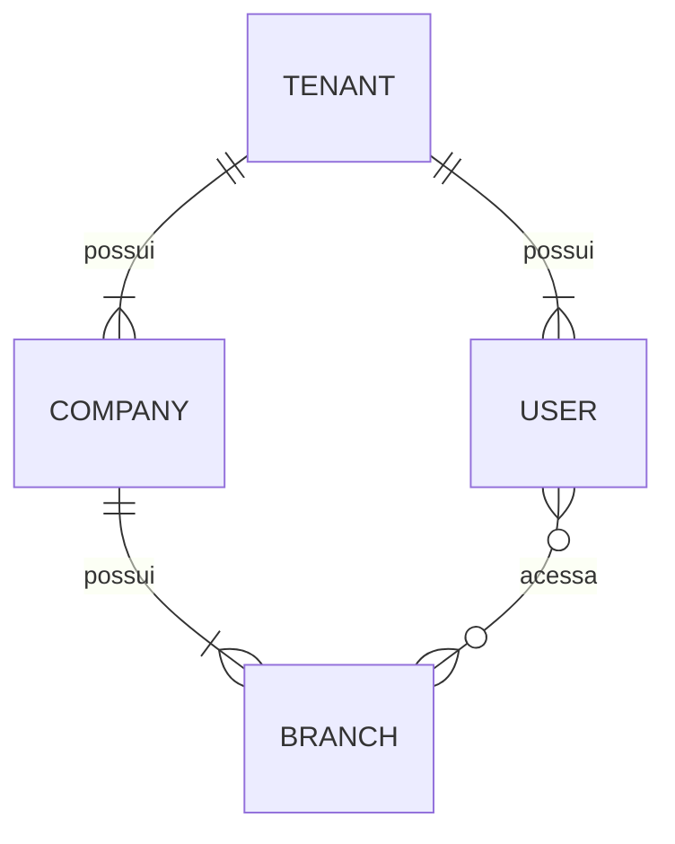

# Banco de dados

## Estado atual
PostgreSQL via Prisma. `apps/api/prisma/schema.prisma` contém apenas o datasource: **nenhum model**, nenhuma migration. A URL de conexão virá de variável de ambiente, nunca do código.

## Versão do Prisma
- O projeto iniciou com **Prisma ORM 7** (CLI fixado em `~7.10.0` em `apps/api`).
- Upgrades de major (ex.: Prisma 8) são **tarefas explícitas e dedicadas**.
- Nunca atualizar a major do Prisma automaticamente como parte de outra feature.
- `@prisma/client` entra junto com os primeiros models.

## Multi-tenancy
- PostgreSQL compartilhado; isolamento lógico por `tenant_id`.
- `tenant_id` obrigatório em toda tabela com dado pertencente ao cliente.
- Constraints devem reforçar o isolamento quando possível: unicidade composta (ex.: matrícula única por `(tenant_id, matricula)`), FKs que incluam `tenant_id`, índices iniciados por `tenant_id`.
- Esquema compatível com RLS; RLS será ativada em fase posterior ([security.md](security.md)).
- Proibido: database-per-tenant e schema-per-tenant.

## Convenções
| Tema | Decisão |
|---|---|
| IDs | UUIDv7 para IDs principais (offline, Edge, sync, idempotência). Mecanismo de geração (aplicação, `uuid(7)` do Prisma ou função do PostgreSQL): **TBD — verificar suporte na versão adotada**. |
| Dinheiro | `numeric`, nunca float. Precisão/escala: **TBD**. |
| Tempo | `timestamptz`, armazenado em UTC. |
| Remoção | **Sem soft delete universal.** Estratégia por entidade: **TBD**. |
| Imutáveis | Vendas, pagamentos, fiscal e auditoria **nunca** são apagados fisicamente. |
| Idempotência | Operações vindas de PDV offline carregam idempotency key única (escopo por tenant). Desenho: **TBD**. |

## Modelo conceitual

Conceitual apenas; não é schema. Todas as entidades de cliente carregam `tenant_id`.

## Migrations
- Migrations aplicadas nunca são editadas.
- Migrations destrutivas exigem revisão explícita.
- Preferir mudanças retrocompatíveis (expand/contract) para permitir deploy gradual e rollback ([deployment.md](deployment.md)).
