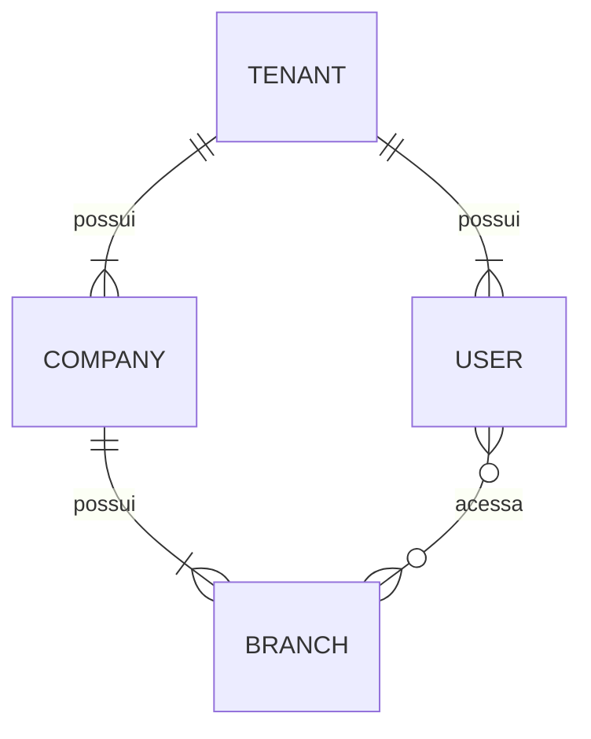

# Banco de dados

## Estado atual
PostgreSQL via Prisma. Models: `Tenant` (tabela `tenants`, migration `20261002000000_create_tenants`) e `Company` (tabela `companies`, migration `20261002010000_create_companies`). A URL de conexão vem de `DATABASE_URL` (lida em `apps/api/prisma.config.ts`), nunca do código.

## Tenant
Raiz do multi-tenancy; por isso **não** possui `tenant_id`.

| Coluna | Tipo PostgreSQL | Nulo | Observação |
|---|---|---|---|
| `id` | `uuid` (PK) | não | UUIDv7 gerado pelo Prisma Client |
| `name` | `text` | não | |
| `status` | enum `tenant_status` | não | `TRIAL`, `ACTIVE`, `PAST_DUE`, `SUSPENDED`, `CANCELLED`; sem default |
| `trial_started_at` | `timestamptz(3)` | sim | |
| `trial_ends_at` | `timestamptz(3)` | sim | |
| `created_at` | `timestamptz(3)` | não | default `CURRENT_TIMESTAMP` |
| `updated_at` | `timestamptz(3)` | não | mantido pelo Prisma (`@updatedAt`) |

Sem soft delete, billing, regra automática de trial ou RLS.

## Company
Empresa de um tenant. Relação **Tenant 1 → N Company**; o MVP começa com uma empresa por tenant, mas **não** há constraint 1:1.

| Coluna | Tipo PostgreSQL | Nulo | Observação |
|---|---|---|---|
| `id` | `uuid` (PK) | não | UUIDv7 gerado pelo Prisma Client (mesma estratégia do Tenant) |
| `tenant_id` | `uuid` | não | FK `tenants.id`, `ON DELETE RESTRICT ON UPDATE RESTRICT` |
| `legal_name` | `text` | não | CHECK `btrim(legal_name) <> ''` |
| `trade_name` | `text` | não | CHECK `btrim(trade_name) <> ''` |
| `cnpj` | `text` | não | somente dígitos; CHECK `cnpj ~ '^[0-9]{14}$'`; `UNIQUE (tenant_id, cnpj)` |
| `status` | enum `company_status` | não | `ACTIVE`, `INACTIVE`; sem default |
| `timezone` | `text` | não | nome IANA (ex.: `America/Sao_Paulo`); **não validado no banco** |
| `created_at` | `timestamptz(3)` | não | default `CURRENT_TIMESTAMP` |
| `updated_at` | `timestamptz(3)` | não | mantido pelo Prisma (`@updatedAt`) |

- Índices: `(tenant_id)`, `(tenant_id, status)` e a unique `(tenant_id, cnpj)`.
- CNPJ não é globalmente único nesta etapa; dígitos verificadores **não** são validados (nem no banco nem na aplicação).
- Os CHECKs de nome rejeitam vazio e somente espaços (`btrim` remove apenas o caractere espaço).
- Remoção física de um Tenant com Company falha (FK `RESTRICT`); sem cascade e sem soft delete.

## CHECK constraints
O schema Prisma não representa CHECKs: eles são escritos à mão na migration. Consequências:
- `prisma migrate diff`/`migrate dev` **não** os geram nem os removem, e o teste de drift **não** os detecta; por isso o teste de migration verifica cada CHECK explicitamente.
- Ao recriar ou alterar a tabela em migration futura, os CHECKs precisam ser mantidos manualmente.
- O schema registra em comentário quais CHECKs existem em cada model.

## Versão do Prisma
- O projeto iniciou com **Prisma ORM 7** (CLI fixado em `~7.10.0` em `apps/api`).
- Upgrades de major (ex.: Prisma 8) são **tarefas explícitas e dedicadas**.
- Nunca atualizar a major do Prisma automaticamente como parte de outra feature.
- `@prisma/client` e `@prisma/adapter-pg` fixados em `~7.10.0`, mesma versão do CLI. No Prisma 7 o client exige driver adapter.
- Client gerado (`prisma-client`, ESM) em `apps/api/src/generated/prisma`, fora do git; `build`, `typecheck` e `test:integration` executam `prisma generate`.
- `PrismaClient` é criado **somente** por `createPrismaClient` (`apps/api/src/database/create-prisma-client.ts`), ver "Fuso da sessão". O ESLint (`npm run lint`) bloqueia `new PrismaClient(...)` e o import de valor de `PrismaClient` em qualquer outro arquivo (import apenas de tipo é permitido).

## Multi-tenancy
- PostgreSQL compartilhado; isolamento lógico por `tenant_id`.
- `tenant_id` obrigatório em toda tabela com dado pertencente ao cliente.
- Constraints devem reforçar o isolamento quando possível: unicidade composta (ex.: matrícula única por `(tenant_id, matricula)`), FKs que incluam `tenant_id`, índices iniciados por `tenant_id`.
- Esquema compatível com RLS; RLS será ativada em fase posterior ([security.md](security.md)).
- Proibido: database-per-tenant e schema-per-tenant.

## Convenções
| Tema | Decisão |
|---|---|
| IDs | UUIDv7 para IDs principais (offline, Edge, sync, idempotência). Gerado pelo Prisma Client via `@default(uuid(7))`, coluna `@db.Uuid` (tipo `uuid`). Sem default no banco: inserts fora do Prisma (SQL bruto, outras ferramentas) precisam informar o `id`. |
| Dinheiro | `numeric`, nunca float. Precisão/escala: **TBD**. |
| Tempo | `timestamptz(3)` (precisão de ms, igual ao `Date` do JS), armazenado em UTC. |
| Remoção | **Sem soft delete universal.** Estratégia por entidade: **TBD**. |
| Imutáveis | Vendas, pagamentos, fiscal e auditoria **nunca** são apagados fisicamente. |
| Idempotência | Operações vindas de PDV offline carregam idempotency key única (escopo por tenant). Desenho: **TBD**. |

## Fuso da sessão
O `@prisma/adapter-pg` 7.10 envia `DateTime` como hora UTC **sem offset** e, ao ler, descarta o offset retornado; ou seja, presume sessão em UTC. Se o banco/servidor tiver outro fuso padrão (ex.: `America/Sao_Paulo`), o Prisma continua lendo o que escreveu, mas o instante gravado fica deslocado (3h) para SQL bruto, workers e `now()`. Por isso `createPrismaClient` abre toda conexão com `-c TimeZone=UTC`. Os testes de integração criam o banco com fuso padrão `America/Sao_Paulo` para detectar regressões.

## Modelo conceitual

Conceitual apenas; não é schema. Todas as entidades de cliente carregam `tenant_id`.

## Migrations
- Migrations aplicadas nunca são editadas.
- Migrations destrutivas exigem revisão explícita.
- Preferir mudanças retrocompatíveis (expand/contract) para permitir deploy gradual e rollback ([deployment.md](deployment.md)).
