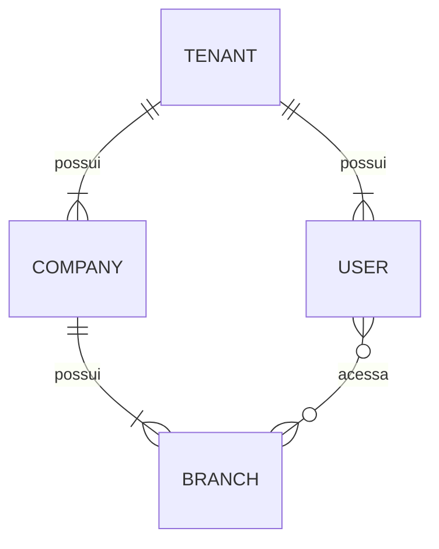

# Banco de dados

## Estado atual
PostgreSQL via Prisma. Models: `Tenant` (tabela `tenants`, migration `20261002000000_create_tenants`), `Company` (tabela `companies`, migration `20261002010000_create_companies`), `Branch` (tabela `branches`, migration `20261002020000_create_branches`), `User` (tabela `users`, migration `20261002030000_create_users`) e `UserBranchAccess` (tabela `user_branch_access`, migration `20261002040000_create_user_branch_access`). A URL de conexão vem de `DATABASE_URL` (lida em `apps/api/prisma.config.ts`), nunca do código.

## Tenant
Raiz do multi-tenancy; por isso **não** possui `tenant_id`.

| Coluna | Tipo PostgreSQL | Nulo | Observação |
|---|---|---|---|
| `id` | `uuid` (PK) | não | UUIDv7 gerado pelo Prisma Client |
| `name` | `text` | não | |
| `status` | enum `tenant_status` | não | `TRIAL`, `ACTIVE`, `PAST_DUE`, `SUSPENDED`, `CANCELLED`; sem default |
| `trial_started_at` | `timestamptz(3)` | sim | |
| `trial_ends_at` | `timestamptz(3)` | sim | |
| `created_at` | `timestamptz(3)` | não | default `CURRENT_TIMESTAMP` |
| `updated_at` | `timestamptz(3)` | não | mantido pelo Prisma (`@updatedAt`) |

Sem soft delete, billing, regra automática de trial ou RLS.

## Company
Empresa de um tenant. Relação **Tenant 1 → N Company**; o MVP começa com uma empresa por tenant, mas **não** há constraint 1:1.

| Coluna | Tipo PostgreSQL | Nulo | Observação |
|---|---|---|---|
| `id` | `uuid` (PK) | não | UUIDv7 gerado pelo Prisma Client (mesma estratégia do Tenant) |
| `tenant_id` | `uuid` | não | FK `tenants.id`, `ON DELETE RESTRICT ON UPDATE RESTRICT` |
| `legal_name` | `text` | não | CHECK `btrim(legal_name) <> ''` |
| `trade_name` | `text` | não | CHECK `btrim(trade_name) <> ''` |
| `cnpj` | `text` | não | somente dígitos; CHECK `cnpj ~ '^[0-9]{14}$'`; `UNIQUE (tenant_id, cnpj)` |
| `status` | enum `company_status` | não | `ACTIVE`, `INACTIVE`; sem default |
| `timezone` | `text` | não | nome IANA (ex.: `America/Sao_Paulo`); **não validado no banco** |
| `created_at` | `timestamptz(3)` | não | default `CURRENT_TIMESTAMP` |
| `updated_at` | `timestamptz(3)` | não | mantido pelo Prisma (`@updatedAt`) |

- Índices: `(tenant_id)`, `(tenant_id, status)`, a unique `(tenant_id, cnpj)` e a unique `(tenant_id, id)` (alvo da FK composta de Branch, criada na migration de Branch).
- CNPJ não é globalmente único nesta etapa; dígitos verificadores **não** são validados (nem no banco nem na aplicação).
- Os CHECKs de nome rejeitam vazio e somente espaços (`btrim` remove apenas o caractere espaço).
- Remoção física de um Tenant com Company falha (FK `RESTRICT`); sem cascade e sem soft delete.

## Branch
Filial/unidade física. Pertence a uma Company **e** ao mesmo Tenant dessa Company. Relações **Tenant 1 → N Branch** e **Company 1 → N Branch**; `tenant_id` é explícito (isolamento e performance), mesmo sendo derivável via Company.

| Coluna | Tipo PostgreSQL | Nulo | Observação |
|---|---|---|---|
| `id` | `uuid` (PK) | não | UUIDv7 gerado pelo Prisma Client |
| `tenant_id` | `uuid` | não | FK `tenants.id` (`RESTRICT`) |
| `company_id` | `uuid` | não | FK composta `(tenant_id, company_id)` → `companies(tenant_id, id)` (`RESTRICT`) |
| `name` | `text` | não | CHECK `btrim(name) <> ''` |
| `code` | `text` | não | código operacional (ex.: `MORUMBI`); CHECK `btrim(code) <> ''`; `UNIQUE (tenant_id, code)`; sem regra de formato/caixa no banco |
| `cnpj` | `text` | sim | CHECK `cnpj IS NULL OR cnpj ~ '^[0-9]{14}$'`; `UNIQUE (tenant_id, cnpj)` |
| `status` | enum `branch_status` | não | `ACTIVE`, `INACTIVE`; sem default |
| `timezone` | `text` | não | nome IANA; **não validado no banco** |
| `created_at` | `timestamptz(3)` | não | default `CURRENT_TIMESTAMP` |
| `updated_at` | `timestamptz(3)` | não | mantido pelo Prisma (`@updatedAt`) |

- Índices: `(tenant_id, company_id)` (também atende a FK composta), `(tenant_id, status)` e as uniques `(tenant_id, code)`, `(tenant_id, cnpj)` e `(tenant_id, id)` (alvo da FK composta de UserBranchAccess, criada no M1.6). Sem índice isolado em `tenant_id`: todos os compostos começam por ele.
- `code` é único por tenant (não por company): duas companies do mesmo tenant não repetem código. A unique compara o texto exato; a camada de aplicação (futura) normalizará o código com **trim + uppercase** antes de gravar, de modo que `morumbi ` e `MORUMBI` não coexistam. Nada disso é imposto no banco hoje.
- CNPJ nulo: a unique usa o padrão `NULLS DISTINCT` do PostgreSQL, logo várias branches sem CNPJ são aceitas e CNPJ preenchido não se repete no tenant. Não é globalmente único e não é comparado com o CNPJ da Company.
- Remoção física de Tenant ou Company com Branch falha (`RESTRICT`); sem cascade e sem soft delete.

### Integridade Tenant/Company (padrão para entidades filhas)
A FK simples `company_id → companies.id` não impede `branches.tenant_id` diferente de `companies.tenant_id`. Por isso:
1. `companies` tem `UNIQUE (tenant_id, id)` (redundante para unicidade, já que `id` é PK, mas necessário como alvo de FK);
2. `branches` referencia `(tenant_id, company_id) → companies(tenant_id, id)`.

O banco então rejeita, por Prisma ou SQL direto: criar Branch do Tenant A com Company do Tenant B; trocar só `company_id` ou só `tenant_id` da Branch para outro tenant; trocar `tenant_id` de uma Company que tem Branches (`ON UPDATE RESTRICT`). Os testes de integração verificam esses casos e que a versão com FK simples falharia. Entidades futuras que referenciem Company/Branch devem seguir o mesmo padrão.

## User
Funcionário individual do tenant (sem usuários compartilhados). Login futuro no PDV por **matrícula + senha**; autenticação **ainda não implementada** (nada de hashing, login, tokens ou lockout nesta etapa). Relação **Tenant 1 → N User**.

| Coluna | Tipo PostgreSQL | Nulo | Observação |
|---|---|---|---|
| `id` | `uuid` (PK) | não | UUIDv7 gerado pelo Prisma Client |
| `tenant_id` | `uuid` | não | FK `tenants.id`, `ON DELETE RESTRICT ON UPDATE RESTRICT` |
| `name` | `text` | não | CHECK `btrim(name) <> ''` |
| `employee_number` | `text` | não | matrícula; CHECK `btrim(employee_number) <> ''`; `UNIQUE (tenant_id, employee_number)`; sem formato numérico imposto |
| `password_hash` | `text` | não | **somente o hash**, gravado sem transformação; CHECK `btrim(password_hash) <> ''` |
| `status` | enum `user_status` | não | `ACTIVE`, `DISABLED` (desativação administrativa), `LOCKED` (bloqueio de segurança); sem default |
| `must_change_password` | `boolean` | não | default `false` |
| `failed_login_attempts` | `integer` | não | default `0`; CHECK `>= 0` |
| `locked_until` | `timestamptz(3)` | sim | |
| `last_login_at` | `timestamptz(3)` | sim | |
| `disabled_at` | `timestamptz(3)` | sim | |
| `created_at` | `timestamptz(3)` | não | default `CURRENT_TIMESTAMP` |
| `updated_at` | `timestamptz(3)` | não | mantido pelo Prisma (`@updatedAt`) |

- Índices: unique `(tenant_id, employee_number)`, `(tenant_id, status)` e unique `(tenant_id, id)` (alvo da FK composta de UserBranchAccess, criada no M1.6).
- **Matrícula única por tenant**, não global: a mesma matrícula pode existir em outro tenant. Comparação exata (sem normalização além de impedir vazio/espaços).
- **Senha nunca é persistida em texto puro.** Não existe coluna `password`, `plain_password`, `temporary_password` nem equivalente; a auditoria do catálogo falha se surgir coluna textual com nome de credencial além de `users.password_hash`. O algoritmo (previsão: Argon2id) pertence ao M2.
- **Sem exclusão física no fluxo normal:** o usuário é desativado (`status = DISABLED`) e permanece no histórico. Sem soft delete universal e sem cascade; Tenant com User não pode ser apagado.
- Coerência entre `status` e `disabled_at`/`locked_until` **não** é imposta no banco (ex.: reativação, bloqueio sem prazo); fica para a camada de aplicação (Auth/M2).

## UserBranchAccess
Define quais filiais um usuário pode acessar: **User 0..N Branches, sempre no mesmo Tenant**. É **separado de papel/permissão**: dizer que o usuário acessa a filial não diz o que ele pode fazer nela. Roles (inclusive por filial) serão modeladas depois. Relações Tenant/User/Branch **1 → N** UserBranchAccess.

| Coluna | Tipo PostgreSQL | Nulo | Observação |
|---|---|---|---|
| `id` | `uuid` (PK) | não | UUIDv7 gerado pelo Prisma Client |
| `tenant_id` | `uuid` | não | FK `tenants.id` (`RESTRICT`) |
| `user_id` | `uuid` | não | FK composta `(tenant_id, user_id)` → `users(tenant_id, id)` (`RESTRICT`) |
| `branch_id` | `uuid` | não | FK composta `(tenant_id, branch_id)` → `branches(tenant_id, id)` (`RESTRICT`) |
| `created_at` | `timestamptz(3)` | não | default `CURRENT_TIMESTAMP` |

- Sem `updated_at`, status, `revoked_at` ou `expires_at`: o vínculo existe ou não existe. Validade temporária será evolução explícita.
- `UNIQUE (tenant_id, user_id, branch_id)`: o mesmo acesso não é concedido duas vezes; também atende consultas por usuário e a FK composta de User. Índice `(tenant_id, branch_id)` para listar usuários de uma filial (e atender a FK composta de Branch).
- O banco rejeita, por Prisma ou SQL: User de outro tenant, Branch de outro tenant, User e Branch de tenants diferentes, e alterações posteriores de `user_id`, `branch_id` ou só `tenant_id` que criem combinação cross-tenant.
- User ou Branch com acesso não pode ser apagado (`RESTRICT`), coerente com a política de desativação; também não pode mudar de tenant (`ON UPDATE RESTRICT` nas FKs compostas).
- Sem regra de "filial padrão", convite ou expiração.

## Integridade organizacional (M1.4)
Regras: relações cross-tenant devem ser **bloqueadas no banco** sempre que possível, não só na aplicação; nenhuma FK organizacional usa `CASCADE`, `SET NULL` ou `SET DEFAULT` (apenas `RESTRICT`).

### `tenant_id` imutável (decisão aprovada)
Depois de criado, um registro pertencente a um tenant **não** muda de tenant (Company, Branch e futuras entidades). O que o banco garante hoje:

| Alteração | Resultado | Mecanismo |
|---|---|---|
| Branch: só `tenant_id` | bloqueada | FK composta `branches_tenant_id_company_id_fkey` |
| Branch: só `company_id` para Company de outro tenant | bloqueada | FK composta |
| Company com Branches: `tenant_id` | bloqueada | FK composta, `ON UPDATE RESTRICT` |
| Company: `tenant_id` para tenant inexistente | bloqueada | `companies_tenant_id_fkey` |
| Branch: `tenant_id` **e** `company_id` juntos, consistentes | **aceita** (lacuna) | — |
| Company **sem** Branches: `tenant_id` para outro tenant existente | **aceita** (lacuna) | — |
| User **sem** acessos: `tenant_id` para outro tenant existente | **aceita** (lacuna) | — |
| User ou Branch **com** acessos: `tenant_id` | bloqueada | FKs compostas de `user_branch_access`, `ON UPDATE RESTRICT` |
| UserBranchAccess: só `tenant_id`, só `user_id` ou só `branch_id` para outro tenant | bloqueada | FKs compostas |
| UserBranchAccess: `tenant_id` + `user_id` + `branch_id` juntos, consistentes | **aceita** (lacuna) | — |
| User: `tenant_id` para tenant inexistente | bloqueada | `users_tenant_id_fkey` |

As lacunas não criam relação cruzada, mas violam a imutabilidade. CHECK não enxerga o valor anterior e FK não impede uma mudança consistente; a proteção robusta é um trigger `BEFORE UPDATE OF tenant_id ... WHEN (OLD.tenant_id IS DISTINCT FROM NEW.tenant_id)` que lança erro, com uma função compartilhada por todas as tabelas de tenant. Foi prototipado em Company/Branch (bloqueia as lacunas e não afeta updates no mesmo tenant), mas por ser um trigger genérico ficou para o **M1.14**. Os testes `GAP (M1.14)` em `org-integrity.int.test.ts` fixam o comportamento atual e devem ser invertidos quando a proteção entrar. Até lá, a camada de aplicação não deve expor alteração de `tenant_id`.

### Auditoria automatizada do catálogo
`org-integrity.int.test.ts` inspeciona o PostgreSQL e falha se: alguma tabela além de `tenants` (e `_prisma_migrations`) não tiver `tenant_id uuid NOT NULL`; faltar a FK direta `tenant_id → tenants(id)`; alguma FK usar `CASCADE`/`SET NULL`/`SET DEFAULT`; uma FK entre tabelas de tenant não incluir `tenant_id` dos dois lados; o conjunto de FKs mudar; ou existir coluna textual com nome de credencial (`password`, `pwd`, `senha`, `secret`, `pin`, `credential`) além de `users.password_hash`. Tabelas novas entram na auditoria automaticamente; tabelas globais (sem tenant) precisarão ser declaradas explicitamente no teste.

### Validações que ficam fora do banco
- **CNPJ completo** (dígitos verificadores; raiz do CNPJ da Branch x Company): responsabilidade futura de `packages/validation`. O banco garante só o formato (14 dígitos) e a unicidade por tenant.
- **Timezone IANA** (Company e Branch): validado na camada de aplicação; o banco guarda texto obrigatório, sem lista própria.
- **Branch.code**: normalização trim + uppercase na aplicação.

## CHECK constraints
O schema Prisma não representa CHECKs: eles são escritos à mão na migration. Consequências:
- `prisma migrate diff`/`migrate dev` **não** os geram nem os removem, e o teste de drift **não** os detecta; por isso o teste de migration verifica cada CHECK explicitamente.
- Ao recriar ou alterar a tabela em migration futura, os CHECKs precisam ser mantidos manualmente.
- O schema registra em comentário quais CHECKs existem em cada model.

## Versão do Prisma
- O projeto iniciou com **Prisma ORM 7** (CLI fixado em `~7.10.0` em `apps/api`).
- Upgrades de major (ex.: Prisma 8) são **tarefas explícitas e dedicadas**.
- Nunca atualizar a major do Prisma automaticamente como parte de outra feature.
- `@prisma/client` e `@prisma/adapter-pg` fixados em `~7.10.0`, mesma versão do CLI. No Prisma 7 o client exige driver adapter.
- Client gerado (`prisma-client`, ESM) em `apps/api/src/generated/prisma`, fora do git; `build`, `typecheck` e `test:integration` executam `prisma generate`.
- `PrismaClient` é criado **somente** por `createPrismaClient` (`apps/api/src/database/create-prisma-client.ts`), ver "Fuso da sessão". O ESLint (`npm run lint`) bloqueia `new PrismaClient(...)` e o import de valor de `PrismaClient` em qualquer outro arquivo (import apenas de tipo é permitido).

## Multi-tenancy
- PostgreSQL compartilhado; isolamento lógico por `tenant_id`.
- `tenant_id` obrigatório em toda tabela com dado pertencente ao cliente.
- Constraints devem reforçar o isolamento quando possível: unicidade composta (ex.: matrícula única por `(tenant_id, matricula)`), FKs que incluam `tenant_id`, índices iniciados por `tenant_id`.
- Esquema compatível com RLS; RLS será ativada em fase posterior ([security.md](security.md)).
- Proibido: database-per-tenant e schema-per-tenant.

## Convenções
| Tema | Decisão |
|---|---|
| IDs | UUIDv7 para IDs principais (offline, Edge, sync, idempotência). Gerado pelo Prisma Client via `@default(uuid(7))`, coluna `@db.Uuid` (tipo `uuid`). Sem default no banco: inserts fora do Prisma (SQL bruto, outras ferramentas) precisam informar o `id`. |
| Dinheiro | `numeric`, nunca float. Precisão/escala: **TBD**. |
| Tempo | `timestamptz(3)` (precisão de ms, igual ao `Date` do JS), armazenado em UTC. |
| Remoção | **Sem soft delete universal.** Estratégia por entidade: **TBD**. |
| Imutáveis | Vendas, pagamentos, fiscal e auditoria **nunca** são apagados fisicamente. |
| Idempotência | Operações vindas de PDV offline carregam idempotency key única (escopo por tenant). Desenho: **TBD**. |

## Fuso da sessão
O `@prisma/adapter-pg` 7.10 envia `DateTime` como hora UTC **sem offset** e, ao ler, descarta o offset retornado; ou seja, presume sessão em UTC. Se o banco/servidor tiver outro fuso padrão (ex.: `America/Sao_Paulo`), o Prisma continua lendo o que escreveu, mas o instante gravado fica deslocado (3h) para SQL bruto, workers e `now()`. Por isso `createPrismaClient` abre toda conexão com `-c TimeZone=UTC`. Os testes de integração criam o banco com fuso padrão `America/Sao_Paulo` para detectar regressões.

## Modelo conceitual

Conceitual apenas; não é schema. Todas as entidades de cliente carregam `tenant_id`.

## Migrations
- Migrations aplicadas nunca são editadas.
- Migrations destrutivas exigem revisão explícita.
- Preferir mudanças retrocompatíveis (expand/contract) para permitir deploy gradual e rollback ([deployment.md](deployment.md)).
