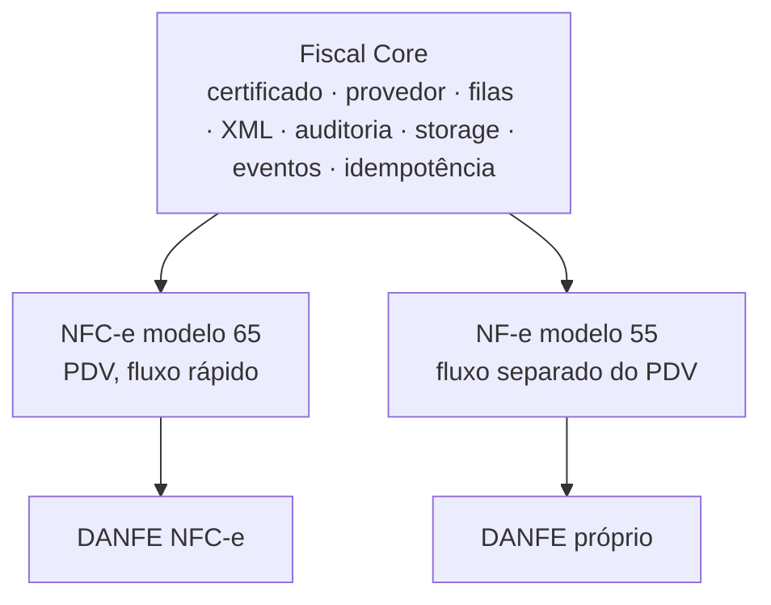

# Fiscal

**Regra:** nenhuma regra fiscal deve ser inventada. Este documento registra apenas a estrutura arquitetural; regras tributárias e de emissão dependem de validação fiscal/jurídica e de fonte oficial.

## Núcleo comum (Fiscal Core)
Compartilhado entre NFC-e e NF-e: certificado, provedor fiscal, filas, XML, auditoria, storage, eventos e idempotência. NF-e e NFC-e **não** são dois sistemas independentes: compartilham o Fiscal Core e especializam comportamentos quando necessário.

A emissão será assíncrona em `apps/worker`; a fila (SQS no futuro) ainda não está implementada.

## NFC-e (modelo 65)
- Prioridade no PDV; fluxo operacional rápido.
- DANFE NFC-e.
- Contingência conforme regras aplicáveis: **TBD — validação fiscal**.

## NF-e (modelo 55)
- Disponível quando necessária; fluxo separado do PDV.
- DANFE próprio; download, envio e impressão sob demanda.
- Não é impressa automaticamente junto às comandas.

## Pendências (TBD)
- Hipóteses de dispensa/emissão seletiva: **TBD — validação fiscal/jurídica**.
- Provedor fiscal; custódia/armazenamento do certificado; regimes tributários suportados.
- Numeração/série, contingência e emissão com PDV offline.
- Prazo de retenção de XML.
