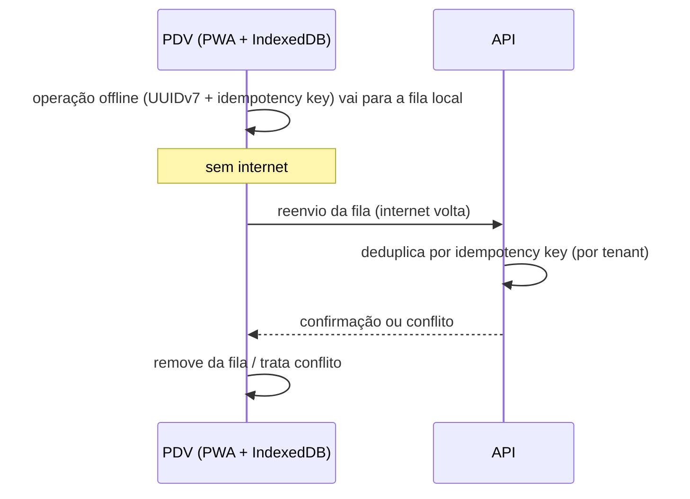
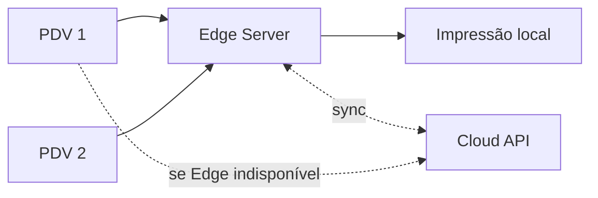

# Offline e Edge

## Princípios
- Web **PWA-first**.
- Offline **parcial**, com foco na continuidade do **PDV**. O backoffice **não** é offline-first.
- A cloud é a fonte definitiva dos dados após reconciliação.

## PDV offline (preparação, não implementado)
- Cache local dos dados necessários à operação.
- IndexedDB para continuidade operacional.
- Fila local de operações.
- UUIDv7 gerado no cliente.
- Idempotency keys para evitar duplicidade.
- Sincronização posterior e operação parcial durante falha de internet.

## Edge Server (opcional e premium) — NÃO implementar agora
- Servidor local opcional, usado por vários PDVs.
- Mantém dados mínimos de operação e fila de sincronização.
- Impressão local.
- Tecnologia prevista: **Node.js + TypeScript**; SQLite local é opção prevista.
- **Não** replica o PostgreSQL inteiro.
- A cloud continua fonte definitiva após reconciliação.

## Pendências (TBD)
- Escopo exato dos dados em cache e política de expiração.
- Operações permitidas offline (pagamento em cartão, NFC-e, desconto, cancelamento).
- Resolução de conflitos e reconciliação.
- Autenticação/permissões com sessão expirada offline.
- Emissão fiscal offline ([fiscal.md](fiscal.md)).
- Protocolo PDV↔Edge e Edge↔Cloud; empacotamento do Edge.
