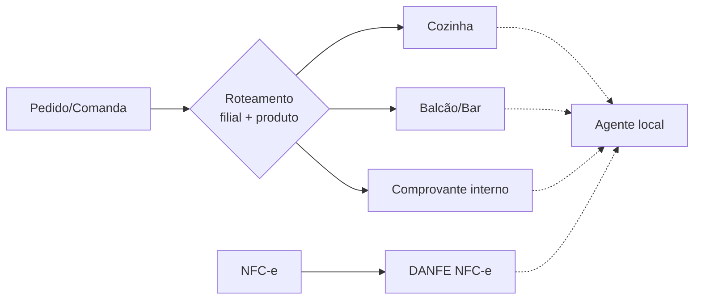

# Impressão

## Agente local
Previsto um agente local de impressão (possivelmente em Rust). **Não implementado.** Pode ser usado diretamente pelo PDV ou via Edge Server ([offline-edge.md](offline-edge.md)).

## Documentos
A mesma impressora pode servir a documentos diferentes:
- comprovante interno;
- comanda;
- DANFE NFC-e.

NF-e **não** é impressa automaticamente junto às comandas ([fiscal.md](fiscal.md)).

## Regras
- Reimpressões são identificadas como tal.
- As últimas comandas ficam acessíveis no PDV.
- Bebidas e produtos prontos podem ser enviados à cozinha conforme configuração.
- Destinos de impressão são configuráveis **por filial e por produto**.

## Pendências (TBD)
Modelos/protocolos de impressora suportados, layout dos documentos, protocolo agente↔PDV/Edge, comportamento em falha de impressão e fila de reimpressão.
