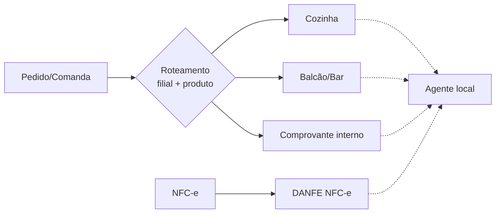

# Impressão

## Agente local
Previsto um agente local de impressão em **Node.js + TypeScript**. **Não implementado.** Pode ser usado diretamente pelo PDV ou via Edge Server ([offline-edge.md](offline-edge.md)).

## Documentos
A mesma impressora pode servir a documentos diferentes:
- comprovante interno;
- comanda;
- DANFE NFC-e.

NF-e **não** é impressa automaticamente junto às comandas ([fiscal.md](fiscal.md)).

## Regras
- Reimpressões são identificadas como tal.
- As últimas comandas ficam acessíveis no PDV.
- Bebidas e produtos prontos podem ser enviados à cozinha conforme configuração.
- Destinos de impressão são configuráveis **por filial e por produto**.

## Comanda pelo navegador (M7)
Decisão de produto (10/11/2026): a comanda é impressa pelo **navegador**, numa térmica de 80 mm instalada no sistema. `POST /branches/:branchId/kitchen-tickets/:ticketId/print` (`order.read` na filial) conta uma via por chamada e devolve `lines`, o texto pronto (função pura `apps/api/src/kitchen/print-layout.ts`, reaproveitável pelo agente ESC/POS):
- no máximo **48 colunas** por linha (code points, depois de NFC), quebra por palavra (palavra maior que a linha é cortada), acentos mantidos;
- cabeçalho: `*** CANCELADO ***` (comanda CANCELLED), `2ª VIA` (via ≥ 2), nome do setor em maiúsculas, `PEDIDO #N` (centralizados), data e hora da criação da comanda no **fuso da filial** (`dd/mm/aaaa hh:mm`);
- `QTDx PRODUTO` por item (continuação alinhada), opções indentadas (`   Grupo: Opção`), observação (`   OBS: ...`), separadores e a linha de corte;
- **sem preços**. A via é contada atomicamente (`print_count`, `last_printed_at`): impressões simultâneas recebem vias diferentes.

## Pendências (TBD)
Modelos/protocolos de impressora suportados, agente local ESC/POS (reaproveita `lines`), protocolo agente↔PDV/Edge, comportamento em falha de impressão e fila de reimpressão. Layout do comprovante interno e do DANFE NFC-e.
