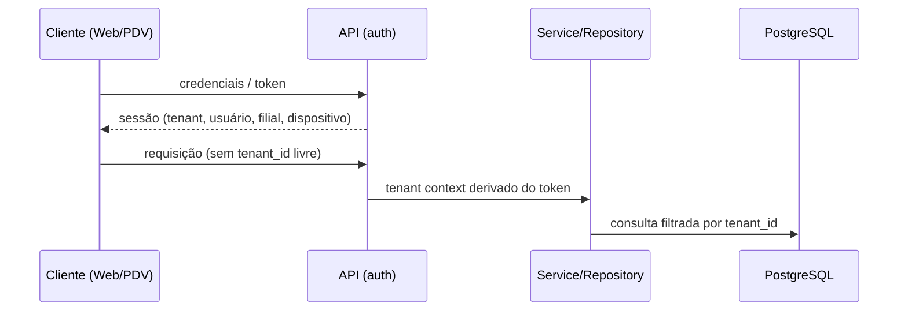
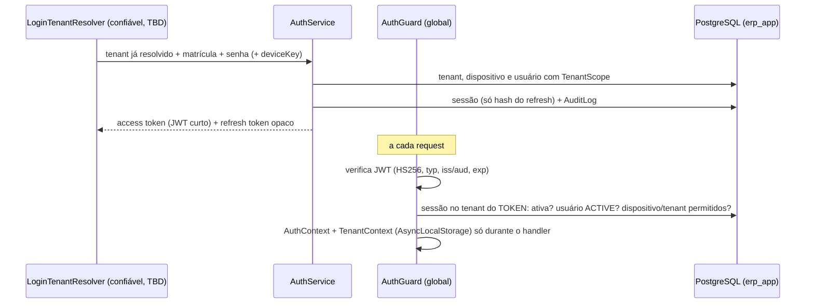

# Segurança

## Diretrizes gerais
- Nenhum secret no código (AWS Secrets Manager em produção). Nenhuma senha de PostgreSQL no git, nos scripts, nos testes ou na documentação.
- Dados fiscais, pagamentos e auditoria são imutáveis fisicamente.

## Isolamento de tenant
1. **Contexto autenticado:** o tenant é derivado da autenticação (usuário/dispositivo), nunca de input livre do frontend. Vale também para clientes offline/Edge: o tenant vem da credencial do dispositivo/sessão.
2. **Aplicação (camada 1, fundação no M2.1):** repository/service obtêm o tenant de `TenantContextService` e o incluem em toda query via `TenantScope` (`tenant_id + id`, nunca só `id`); sem contexto, falham com `TenantContextMissingError` antes de consultar o banco ([architecture.md](architecture.md)). Sem RLS, o banco garante escrita e relacionamentos dentro do tenant, mas **não** impede `erp_app` de ler ou enumerar linhas de outro tenant: o isolamento de leitura depende desta camada. `TenantContext` representa um contexto **já resolvido e confiável**; não autentica ninguém. Em runtime, só o AuthGuard o preenche (M2.7), a partir do access token verificado e da sessão ativa no banco; testes e infraestrutura chamam `run()` diretamente. Nunca preencher a partir de header, body, query string ou parâmetro do cliente (`X-Tenant-Id` não é identidade).
3. **Banco:** `tenant_id` obrigatório e constraints reforçando o isolamento quando possível. Relações cross-tenant devem ser **impossíveis no banco** sempre que viável (FK composta incluindo `tenant_id`, ver [database.md](database.md)); FKs organizacionais nunca usam cascade.
   - **`tenant_id` é imutável no banco** para toda entidade editável pertencente a tenant (decisão fechada, M1.14.1): trigger `BEFORE UPDATE OF tenant_id` por tabela, com a função compartilhada `forbid_tenant_id_change()`, rejeita (SQLSTATE `23000`) qualquer mudança real de `tenant_id`, via Prisma ou SQL, mesmo quando as FKs mudam juntas de forma consistente. Updates que não mudam o valor seguem livres. `audit_logs` usa política própria (append-only). Toda nova tabela de tenant precisa do trigger; a auditoria do catálogo falha sem ele. `erp_app` não consegue desabilitar nem alterar o trigger ou a função (M1.14.2b); o dono e a identidade admin conseguem.
   - **Identidades do banco separadas (M1.14.2b):** a aplicação e os workers conectam como `erp_app`, que não é dona de nenhum objeto, não é membro de `erp_migrator`, não cria objetos e tem só a matriz explícita de privilégios ([database.md](database.md)); migrations e seed rodam como `erp_migrator`, dono dos objetos, nunca usado em runtime; a identidade admin (superusuário ou master do RDS) só provisiona roles/banco e nunca é `DATABASE_URL` da aplicação. Roles não fazem parte das Prisma migrations (`infrastructure/postgres/`).
   - **Camadas hoje:** (1) TenantContext + queries scoped na aplicação (leitura e escrita); (2) FKs compostas, constraints e triggers do PostgreSQL (integridade de escrita, independente da aplicação). Futuro: RLS como defesa adicional de leitura.
4. **RLS (fase posterior):** segunda camada de proteção; **não ativa** hoje. Mecanismo de transmissão do tenant à sessão do banco e interação com pool de conexões/Prisma: **TBD**.
5. **Testes:** testes de isolamento multi-tenant obrigatórios ([testing-strategy.md](testing-strategy.md)).

## Fluxo de contexto (conceitual)

## Autenticação, autorização e dispositivos (M2)
Implementação em `apps/api/src/auth/`, `apps/api/src/authorization/` e `apps/api/src/tenants/`. Os serviços são **transport-neutral**; o único transporte HTTP hoje é `Authorization: Bearer` para o access token. Autenticação das identidades do PostgreSQL em produção (Secrets Manager ou IAM database authentication): **TBD**.

### Fluxo

### Senhas (Argon2id, M2.2)
- `PasswordHasher` é o único ponto que gera/verifica senha: **somente Argon2id** (`argon2`), parâmetros centrais `ARGON2ID_PARAMS` (m = 19 MiB, t = 2, p = 1, baseline mínimo recomendado pela OWASP; não há benchmark do hardware de produção — revisar com medição no alvo de deploy e, havendo folga de latência/memória, subir para m = 46 MiB/t = 1 ou m = 64 MiB/t = 3; o rehash no login migra os hashes existentes), salt gerado pela biblioteca, hash PHC autocontido em `users.password_hash`. Hash com parâmetros antigos é recalculado no próximo login correto.
- Entrada limitada a `password.maxBytes` (1 KiB, UTF-8) antes de qualquer hash (proteção contra DoS). Hash armazenado que não é Argon2id = falha genérica (`InvalidPasswordHashError`), nunca sucesso nem 500 com detalhes.
- Senha nova (troca/reset): só tamanho mínimo `password.minLength` (**DECISION REQUIRED**, default técnico 8); nenhuma regra de complexidade foi aprovada. Sem normalização Unicode.
- Senha, senha temporária e hash nunca vão para log, erro, resposta ou AuditLog.

### Login (M2.3)
- `AuthService.login(resolvedTenant, { employeeNumber, password, deviceKey?, client? })`, dentro de um tenant **já resolvido** por uma implementação de `LoginTenantResolver`. **DECISION REQUIRED:** como o tenant é descoberto antes do login (dispositivo pareado, subdomínio, código de loja...). Enquanto não houver decisão, **não existe endpoint de login** nem `X-Tenant-Id`, slug ou `tenantId` livre.
- Ordem fixa: status do tenant → dispositivo declarado → usuário → bloqueios → senha. Dispositivo e tenant são verificados **antes** da senha, para não virarem oráculo de senha certa/errada.
- Matrícula comparada exatamente (normalização: **DECISION REQUIRED**). Matrícula inexistente, senha errada, `DISABLED`, `LOCKED` e bloqueio temporário retornam o **mesmo** `InvalidCredentialsError` (401 `invalid_credentials`); o motivo real fica no erro interno e no AuditLog. Quando não há senha a verificar, uma verificação Argon2id equivalente é executada (equalização de tempo). **Decidido no gate do M2:** a resposta externa continua genérica (não revela usuário inexistente, senha errada, desativado nem bloqueado); a causa segura fica só no AuditLog.
- Sucesso, numa transação: zera `failed_login_attempts` e `locked_until`, grava `last_login_at` (e o rehash), cria a Session e registra `auth.login.succeeded`. `must_change_password` é devolvido e imposto pelo AuthGuard.
- Status do Tenant que autenticam: `TRIAL`, `ACTIVE`, `PAST_DUE`; `SUSPENDED`/`CANCELLED` recebem 403 `tenant_unavailable` (**DECISION REQUIRED**; trial vencido não é avaliado).

### Status do usuário e lockout (M2.13)
- `DISABLED` (desativação administrativa) e `LOCKED` (bloqueio de segurança **sem prazo**): nunca autenticam, não renovam sessão e sessões existentes deixam de valer no request seguinte. O Auth **nunca** altera `status`; quem coloca/retira `LOCKED` e a coerência com `disabled_at` são fluxos administrativos ainda não definidos (**DECISION REQUIRED**).
- **Bloqueio temporário = `locked_until` no futuro, com `status` inalterado (`ACTIVE`).** Cada senha errada incrementa `failed_login_attempts` atomicamente no PostgreSQL (UPDATE com lock de linha na transação: tentativas simultâneas não perdem incremento); ao atingir `lockout.maxFailedAttempts`, grava `locked_until = agora + lockout.durationMs` e zera o contador (`auth.lockout.triggered`). Durante o bloqueio a senha **não** é verificada e nada é contado. Valores (5 tentativas, 15 min) em `AUTH_SECURITY_POLICY`: **DECISION REQUIRED**.
- O bloqueio temporário **não** derruba sessões existentes nem impede refresh: senão errar a senha de propósito encerraria as sessões da vítima.
- **Throttling:** não há rate limit em memória (não é defesa em ambiente multi-instância, e ainda não há endpoint público de login). O lockout persistido é a única defesa implementada; rate limiting distribuído (gateway/WAF/Redis) é **futuro**, junto com o endpoint de login.

### Access token (M2.4)
- JWT **HS256** (`jose`), header `typ: at+jwt`, `iss`/`aud` = `erp-api`. Claims mínimas: `sub` (userId), `tid` (tenantId), `sid` (sessionId), `did` (deviceId, só se houver), `jti`, `iat`, `exp`. Nada de permissões, nome, status ou hashes.
- A verificação aceita só HS256 (rejeita `alg=none` e qualquer outro algoritmo) e exige `typ`, emissor, audiência, expiração e o formato UUID de cada claim. Chave em `AUTH_ACCESS_TOKEN_SECRET` (>= 32 bytes; ausente, curta ou placeholder = a API não sobe, em qualquer ambiente). TTL padrão 15 min (**DECISION REQUIRED**).
- O token sozinho não basta: o AuthGuard consulta a sessão a cada request, então logout, revogação e desativação valem no request seguinte (custo medido no gate do M2: 3 statements por request — sessão, usuário, tenant — e 4 quando a sessão tem dispositivo; todas por PK/unique com `tenant_id`. Trade-off deliberado pela revogação imediata; sem cache. Reduzir para 1 exigiria `relationJoins` (preview, muda a estratégia de todo o Prisma) ou SQL manual revisado — reavaliar com carga real).

### Refresh token e Session (M2.5/M2.6)
- Formato `rt1.<tenantId>.<sessionId>.<secret>.<proof>`, com `secret` = 32 bytes de `crypto.randomBytes` (base64url) e `proof` = HMAC-SHA256(K, `rt1|tenantId|sessionId|secret`), K derivada do `AUTH_ACCESS_TOKEN_SECRET` por HKDF com rótulo próprio (nunca a chave do JWT). `tenantId`/`sessionId` não são segredo: só localizam a sessão **com TenantScope** (sem consulta fora de tenant). Prova inválida = `invalid_refresh_token` **antes de qualquer acesso ao banco**, sem revogar nada. Trocar o segredo do Auth invalida todos os refresh tokens.
- Persistido **somente** `sha256$<base64url(SHA-256(secret))>` em `sessions.refresh_token_hash` (SHA-256 basta para segredo de alta entropia; Argon2id não é usado aqui). Token puro e access token nunca são persistidos nem logados.
- `expires_at` = login + TTL do refresh (padrão 12 h, **DECISION REQUIRED**, ligado à expiração offline #5). Vida **absoluta**: a rotação não estende.
- **Rotação:** cada refresh valida a sessão (não revogada nem expirada), usuário `ACTIVE`, dispositivo e tenant permitidos e o hash, e troca o hash por um novo num **UPDATE condicional** (`tenant_id`, `id`, `refresh_token_hash = <apresentado>`, `revoked_at IS NULL`, `expires_at > agora`). O token antigo deixa de valer no mesmo comando; de refreshes concorrentes, no máximo um rotaciona.
- **Replay:** sessão identificada mas segredo diferente do atual (token já rotacionado, ou corrida de dois refreshes) → a sessão é **revogada** (`auth.refresh.replay_detected` + `auth.session.revoked`) e todos os tokens dela morrem. Só conta como replay um token com **prova válida** (emitido pelo servidor para aquela sessão). Corrigido no gate do M2: antes, qualquer um que conhecesse `tenantId` + `sessionId` (presentes em todo access token e no `resource_id` do AuditLog) revogava a sessão alheia enviando um segredo aleatório; agora isso exige ter possuído um refresh token emitido para ela. Consequência aceita: clientes devem serializar o refresh (dois refreshes simultâneos com o mesmo token revogam a sessão). A rotação não usa lock explícito: o UPDATE condicional em READ COMMITTED reavalia a linha após o lock e só um vence.
- **Logout e revogação (`SessionService`):** logout da sessão atual, revogação de uma sessão, de todas as sessões de um usuário (opcionalmente preservando uma) e de todas as de um dispositivo. Sempre `revoked_at` (UPDATE condicional, idempotente), nunca DELETE. Retenção/limpeza de sessões antigas segue pendente.

### AuthGuard, AuthContext e TenantContext (M2.7)
- `AuthGuard` é **global** (`APP_GUARD`) e nega por padrão; só rotas `@Public()` (hoje apenas `/health`) dispensam token. `@Public()` e `@AllowWhenPasswordChangeRequired()` são **só de método** e lidas só do handler: marca na classe ou herdada de classe base nunca torna um controller público (endurecido no gate). Mais de um header `Authorization` nunca autentica (o Node mantém só o primeiro; um proxy pode ler o último). Contextos não HTTP são recusados. Extrai `Authorization: Bearer`, verifica o JWT e, **no tenant do token** (nunca de header, body, query ou parâmetro), carrega a sessão com TenantScope e exige `user_id`/`device_id` iguais às claims e as regras de `sessionInvalidity` (as mesmas do refresh).
- `AuthContext = { tenantId, userId, sessionId, deviceId, mustChangePassword }` é separado do `TenantContext` (que continua `{ tenantId }`). O `AuthContextInterceptor` inscreve o handler dentro de `AuthContextService.run()`, que abre os dois contextos com o mesmo tenant; fora do handler não existe contexto (testado com requests concorrentes de dois tenants). `@CurrentAuth()` injeta o contexto no handler.
- `must_change_password`: toda rota responde 403 `password_change_required`, exceto as marcadas com `@AllowWhenPasswordChangeRequired()` (`POST /auth/logout`, `POST /auth/password`).
- Erros: `AuthExceptionFilter` devolve só `{ "error": "<código público>" }`; 401 = não autenticado/sessão inválida; 403 = autenticado sem permissão, tenant indisponível, dispositivo não permitido ou troca de senha obrigatória.
- **DECISION REQUIRED — transporte dos tokens no cliente** (memória, cookie HttpOnly + CSRF, BFF...). Nada foi decidido nem implementado no frontend; por isso **refresh e login não têm endpoint**. Aceitar Bearer no backend não obriga o frontend a guardar o token em `localStorage`.

### Dispositivos (M2.8)
- `device_key` continua **identificador, não segredo**. O login pode declarar um dispositivo: ele precisa existir no mesmo tenant e ter status permitido; senão 403 `device_not_allowed` e nenhuma sessão é criada. A sessão guarda `device_id`, o token leva `did` e o `AuthContext` traz `deviceId`. Sessão sem dispositivo continua permitida.
- `REVOKED` nunca cria, renova nem usa sessão. `INACTIVE` ("fora de uso temporário") é tratado igual (**decidido no gate do M2**). `SessionService.revokeAllForDevice` encerra as sessões de um dispositivo.
- **Não implementado (DECISION REQUIRED/futuro):** pairing, segredo/certificado de dispositivo, QR, autenticação autônoma de PDV, heartbeat (`last_seen_at`) e se o usuário precisa de acesso à filial do dispositivo. Sem pairing, declarar um dispositivo só **restringe** a sessão; não prova que o pedido vem dele.

### Autorização (M2.9/M2.10)
- `AuthorizationService` (`getEffectivePermissions`, `hasPermission`, `hasAllPermissions`, `hasAnyPermission`) resolve a cada chamada, numa única query (RolePermission ⨝ Role ⨝ UserRole ⨝ User ⨝ Permission) com TenantScope. Nada de permissões no JWT nem cache.
- Concede só: usuário `ACTIVE` + role `ACTIVE` (`INACTIVE`/`ARCHIVED` = nada) + vínculos do tenant atual.
- **Escopo explícito (`AuthorizationScope`):** `tenant` = só roles tenant-wide (`branch_id IS NULL`); role de filial **nunca** vira permissão global. `branch` = roles tenant-wide + roles daquela filial, **somente se o usuário tem `UserBranchAccess` àquela filial** (decidido no gate do M2: a role diz O QUE, o acesso diz ONDE; sem acesso = nenhuma permissão na filial, mesmo com role tenant-wide); filial inexistente ou de outro tenant não pode ter acesso (FK composta) = nenhuma permissão. O `branchId` vem do recurso/rota alvo ou de API interna, nunca de header, e é sempre revalidado no tenant autenticado.
- **Guards:** `@RequirePermissions(...codes)` (escopo do tenant) e `@RequireBranchPermissions("branchId", ...codes)` (filial do parâmetro de rota); `PermissionGuard` global, registrado logo após o AuthGuard: 401 sem autenticação, 403 sem permissão. Semântica: todas as permissões listadas são exigidas (AND); requisitos na classe e no método valem **juntos** (o método não substitui a classe); código inexistente no catálogo nunca concede. Controllers dependem de códigos de permissão, nunca de nomes de role.

### Roles padrão e provisionamento (M2.11)
- `TenantProvisioningService.provisionDefaultRoles()` cria `OWNER`, `MANAGER`, `ATTENDANT` e `KITCHEN` (`is_system = true`, `ACTIVE`) no tenant do contexto e acrescenta os vínculos da matriz, numa transação, com `INSERT ... ON CONFLICT DO NOTHING` (idempotente e seguro sob concorrência). Nunca remove vínculos, nunca altera role existente e nunca assume uma role customizada que use um código padrão (reportada em `conflicts`). Roda como `erp_app`.
- **DECISION REQUIRED — default role permission matrix:** `DEFAULT_ROLE_PERMISSIONS` (`apps/api/src/tenants/default-roles.ts`) está **vazia para as quatro roles, inclusive OWNER**. Até a decisão, as roles padrão não concedem nada. Também pendentes: reserva dos códigos padrão, proteção de roles `is_system` e quando o provisionamento roda (não existe criação de tenant ainda).

### Troca e reset de senha (M2.12)
- `POST /auth/password` (`PasswordService.changeOwnPassword`): exige a senha atual (errada conta para o lockout; durante bloqueio temporário nada é verificado), grava o novo hash, limpa `must_change_password` e revoga as **demais** sessões do usuário.
- `PasswordService.resetPassword(userId, temporária)` (sem endpoint: não há API de administração de usuários): por usuário autenticado do mesmo tenant; a autorização é de quem chama (`PermissionGuard`). Grava só o hash, `must_change_password = true`, zera contador e bloqueio temporário e revoga **todas** as sessões do alvo; não muda `DISABLED`/`LOCKED`. Gerar e entregar a senha temporária é responsabilidade externa. Recuperação por e-mail: não aprovada, não implementada.

**Acesso a filiais (`UserBranchAccess`) é separado de papel/permissão.** O vínculo só diz quais filiais (0..N) o usuário pode acessar; o que ele pode fazer vem de roles/permissions. O vínculo só existe dentro do mesmo tenant (FKs compostas), e role por filial exige o vínculo (FK de `user_roles`).

**Permission é um catálogo global**, controlado pelo sistema (seed), sem `tenant_id`; `code` é identificador estável. O que varia por tenant é quais permissões cada Role tem, via `RolePermission`.

## Auditoria
Módulo `audit`; registros não apagáveis fisicamente. Escopo geral dos eventos auditados: **TBD**; os eventos de segurança do Auth já são gravados (abaixo).

**Eventos de segurança do Auth (M2)** via `SecurityAuditWriter` (`apps/api/src/audit/security-audit.ts`), na mesma transação da operação quando há uma: `auth.login.succeeded`, `auth.login.failed` (`reason`), `auth.password.change_failed` (senha atual errada na troca; conta para o lockout), `auth.lockout.triggered` (`locked_until`), `auth.session.revoked` (`reason`), `auth.sessions.revoked` (`reason`, `count`), `auth.refresh.replay_detected`, `auth.password.changed`, `auth.password.reset` (ator em `user_id`, alvo em `resource_id`). Cada evento é um tipo fechado; `metadata` só aceita a allowlist `reason`, `count`, `locked_until` com valores enumerados/inteiros (metadata não-objeto também falha) (qualquer outra chave falha). **Nunca** gravados: senha, matrícula digitada (pode ser uma senha no campo errado), access/refresh token, `password_hash`, `refresh_token_hash`, objeto de request/DTO. Falha de login com matrícula inexistente grava `user_id NULL`. Risco: cada tentativa falha gera uma linha (amplificação de escrita sob ataque). Mitigação possível sem perder auditabilidade, ainda não implementada: agregar falhas de matrícula inexistente por janela. **Rate limiting distribuído (por IP/dispositivo, no gateway/WAF) é obrigatório antes de expor o login à internet**; não bloqueia desenvolvimento/MVP sem endpoint público.

**AuditLog** ([database.md](database.md)) é a estrutura persistente da trilha: por tenant, com usuário, filial e dispositivo opcionais (do mesmo tenant quando presentes, garantido por FKs compostas). Eventos sem usuário (workers, rotinas, sistema, só dispositivo) usam `user_id NULL`; não existe usuário fictício `SYSTEM`. `action` e `resource_type` são identificadores técnicos validados por CHECK de formato, sem enum; `resource_id` é referência lógica sem FK, para que o log sobreviva ao recurso. Só o Auth grava eventos (M2); instrumentação dos demais módulos e um `AuditService` geral são etapas futuras.

- **Append-only imposto pelo PostgreSQL:** os triggers `audit_logs_append_only` (UPDATE/DELETE, por linha) e `audit_logs_no_truncate` (TRUNCATE, por statement), ambos com a função `forbid_audit_log_mutation()` específica desta tabela, rejeitam fisicamente todo `UPDATE`, `DELETE` e `TRUNCATE` (inclusive TRUNCATE em cascata a partir de tabela pai), vindos do Prisma, de SQL direto ou de qualquer ferramenta. Só `INSERT` é permitido; correção de um evento = novo evento. É distinto do trigger genérico de `tenant_id` (M1.14.1), que `audit_logs` não usa.
- **Duas camadas independentes (M1.14.2b):** `erp_app` só tem `SELECT, INSERT` em `audit_logs` (UPDATE/DELETE/TRUNCATE negados por privilégio, `42501`) e, além disso, os triggers append-only rejeitam essas operações para qualquer identidade com privilégio de escrita. `erp_app` não executa as funções de proteção diretamente, não as altera, não desabilita/remove/cria triggers, não executa DDL e não consegue `SET session_replication_role = replica`.
- **Fronteira:** o dono dos objetos (`erp_migrator`) e a identidade admin ainda podem desabilitar triggers, alterar funções e executar DDL destrutivo; a mitigação é operacional (credenciais restritas ao pipeline de deploy e ao provisionamento, nunca à aplicação). Auditoria de ações do próprio pipeline/admin e mecanismo de autenticação em produção: TBD.
- **`metadata` (jsonb) nunca guarda credenciais nem segredos:** senha, `password_hash`, refresh/access token, `refresh_token_hash`, API key, segredo, chave privada, PIN, dados completos de cartão. Não há sanitizador automático nem verificação de conteúdo no banco; a auditoria de credenciais do catálogo checa só nomes de colunas. O `SecurityAuditWriter` do Auth já usa allowlist; o futuro `AuditService` geral deve seguir o mesmo padrão.
- `ip_address` e `metadata` podem conter dado pessoal: retenção e LGPD pendentes (#9).

## Automação externa
n8n e integrações só alteram dados críticos via API autenticada; nunca por acesso direto ao banco.

## Privacidade/LGPD
A imutabilidade física de vendas, pagamentos, fiscal e auditoria precisa ser conciliada com pedidos de eliminação de dados pessoais: **TBD — validação jurídica**.
