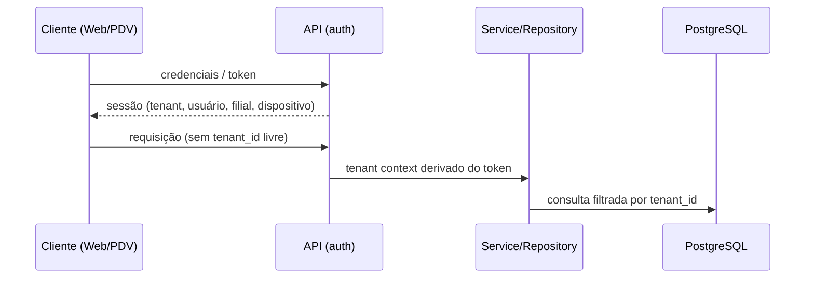

# Segurança

## Diretrizes gerais
- Nenhum secret no código (AWS Secrets Manager em produção).
- Dados fiscais, pagamentos e auditoria são imutáveis fisicamente.

## Isolamento de tenant
1. **Contexto autenticado:** o tenant é derivado da autenticação (usuário/dispositivo), nunca de input livre do frontend. Vale também para clientes offline/Edge: o tenant vem da credencial do dispositivo/sessão.
2. **Aplicação:** repository/service exigem tenant context; acesso sem contexto deve falhar.
3. **Banco:** `tenant_id` obrigatório e constraints reforçando o isolamento quando possível. Relações cross-tenant devem ser **impossíveis no banco** sempre que viável (FK composta incluindo `tenant_id`, ver [database.md](database.md)); FKs organizacionais nunca usam cascade.
   - **`tenant_id` é imutável:** um registro nunca é movido para outro tenant. Hoje o banco bloqueia as trocas que gerariam vínculo cruzado, mas ainda aceita uma mudança consistente (Company sem filiais; Branch com `tenant_id` + `company_id` juntos). O mesmo vale para User sem acessos, para UserBranchAccess movido por inteiro (`tenant_id` + `user_id` + `branch_id`) e para Role. Proteção no banco prevista para o M1.14; até lá, nenhuma API/serviço pode permitir alterar `tenant_id`.
4. **RLS (fase posterior):** segunda camada de proteção; **não ativa** hoje. Mecanismo de transmissão do tenant à sessão do banco e interação com pool de conexões/Prisma: **TBD**.
5. **Testes:** testes de isolamento multi-tenant obrigatórios ([testing-strategy.md](testing-strategy.md)).

## Fluxo de contexto (conceitual)

## Autenticação, autorização e dispositivos
Módulos `auth`, `roles`, `permissions`, `devices` (ver [architecture.md](architecture.md)). Mecanismo de autenticação, política de sessão, expiração offline e modelo de permissões: **TBD**.

**Autenticação ainda não está implementada.** Existe apenas o model persistente `User` ([database.md](database.md)):
- login previsto no PDV por matrícula (única por tenant) + senha; usuários são individuais;
- a senha **nunca** é persistida em texto puro: só `password_hash`, produzido pela futura camada Auth (algoritmo no M2, previsão Argon2id); não há coluna de senha temporária em texto;
- `must_change_password`, `failed_login_attempts`, `locked_until` e `last_login_at` existem, mas nenhuma lógica os altera ainda;
- usuário desativado (`DISABLED`) permanece no histórico; não há exclusão física no fluxo normal.

**Acesso a filiais (`UserBranchAccess`) é separado de papel/permissão.** O vínculo só diz quais filiais (0..N) o usuário pode acessar; o que ele pode fazer será definido por roles/permissions (inclusive por filial), ainda não modelados. O vínculo só existe dentro do mesmo tenant, garantido no banco por FKs compostas com `tenant_id`. Nenhuma verificação de acesso (guard/autorização) está implementada.

**Roles (RBAC) pertencem ao Tenant** ([database.md](database.md)). Códigos padrão previstos: `OWNER`, `MANAGER`, `ATTENDANT`, `KITCHEN`, criados futuramente no provisionamento do Tenant; roles customizadas são suportadas. Hoje uma Role **não concede nenhuma permissão**: Permission, RolePermission e a atribuição de roles a usuários (UserRole) ainda não existem.

## Auditoria
Módulo `audit`; registros não apagáveis fisicamente. Escopo dos eventos auditados: **TBD**.

## Automação externa
n8n e integrações só alteram dados críticos via API autenticada; nunca por acesso direto ao banco.

## Privacidade/LGPD
A imutabilidade física de vendas, pagamentos, fiscal e auditoria precisa ser conciliada com pedidos de eliminação de dados pessoais: **TBD — validação jurídica**.
