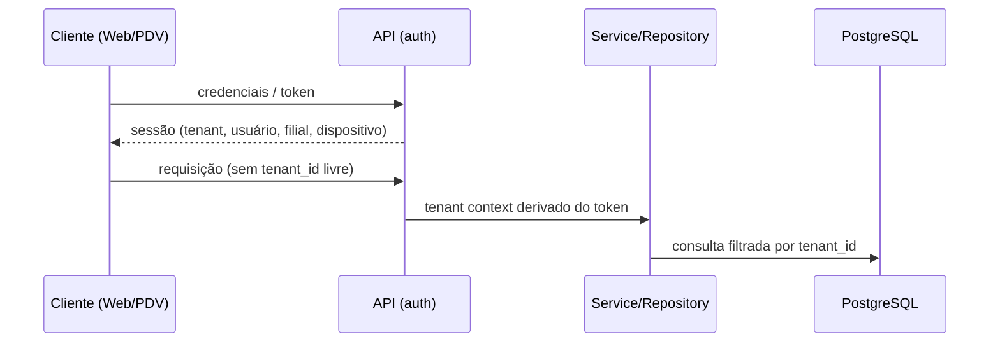

# Segurança

## Diretrizes gerais
- Nenhum secret no código (AWS Secrets Manager em produção). Nenhuma senha de PostgreSQL no git, nos scripts, nos testes ou na documentação.
- Dados fiscais, pagamentos e auditoria são imutáveis fisicamente.

## Isolamento de tenant
1. **Contexto autenticado:** o tenant é derivado da autenticação (usuário/dispositivo), nunca de input livre do frontend. Vale também para clientes offline/Edge: o tenant vem da credencial do dispositivo/sessão.
2. **Aplicação (camada 1, fundação no M2.1):** repository/service obtêm o tenant de `TenantContextService` e o incluem em toda query via `TenantScope` (`tenant_id + id`, nunca só `id`); sem contexto, falham com `TenantContextMissingError` antes de consultar o banco ([architecture.md](architecture.md)). Sem RLS, o banco garante escrita e relacionamentos dentro do tenant, mas **não** impede `erp_app` de ler ou enumerar linhas de outro tenant: o isolamento de leitura depende desta camada. `TenantContext` representa um contexto **já resolvido e confiável**; não autentica ninguém. Hoje só testes o preenchem; no M2, Auth/guards transformarão sessão/token (usuário, tenant e, quando aplicável, dispositivo/filial) em contexto. Nunca preencher a partir de header, body, query string ou parâmetro do cliente (`X-Tenant-Id` não é identidade).
3. **Banco:** `tenant_id` obrigatório e constraints reforçando o isolamento quando possível. Relações cross-tenant devem ser **impossíveis no banco** sempre que viável (FK composta incluindo `tenant_id`, ver [database.md](database.md)); FKs organizacionais nunca usam cascade.
   - **`tenant_id` é imutável no banco** para toda entidade editável pertencente a tenant (decisão fechada, M1.14.1): trigger `BEFORE UPDATE OF tenant_id` por tabela, com a função compartilhada `forbid_tenant_id_change()`, rejeita (SQLSTATE `23000`) qualquer mudança real de `tenant_id`, via Prisma ou SQL, mesmo quando as FKs mudam juntas de forma consistente. Updates que não mudam o valor seguem livres. `audit_logs` usa política própria (append-only). Toda nova tabela de tenant precisa do trigger; a auditoria do catálogo falha sem ele. `erp_app` não consegue desabilitar nem alterar o trigger ou a função (M1.14.2b); o dono e a identidade admin conseguem.
   - **Identidades do banco separadas (M1.14.2b):** a aplicação e os workers conectam como `erp_app`, que não é dona de nenhum objeto, não é membro de `erp_migrator`, não cria objetos e tem só a matriz explícita de privilégios ([database.md](database.md)); migrations e seed rodam como `erp_migrator`, dono dos objetos, nunca usado em runtime; a identidade admin (superusuário ou master do RDS) só provisiona roles/banco e nunca é `DATABASE_URL` da aplicação. Roles não fazem parte das Prisma migrations (`infrastructure/postgres/`).
   - **Camadas hoje:** (1) TenantContext + queries scoped na aplicação (leitura e escrita); (2) FKs compostas, constraints e triggers do PostgreSQL (integridade de escrita, independente da aplicação). Futuro: RLS como defesa adicional de leitura.
4. **RLS (fase posterior):** segunda camada de proteção; **não ativa** hoje. Mecanismo de transmissão do tenant à sessão do banco e interação com pool de conexões/Prisma: **TBD**.
5. **Testes:** testes de isolamento multi-tenant obrigatórios ([testing-strategy.md](testing-strategy.md)).

## Fluxo de contexto (conceitual)

## Autenticação, autorização e dispositivos
Módulos `auth`, `roles`, `permissions`, `devices` (ver [architecture.md](architecture.md)). Mecanismo de autenticação, política de sessão, expiração offline e modelo de permissões: **TBD**. Autenticação das identidades do PostgreSQL (`erp_migrator`, `erp_app`) em produção — senha via Secrets Manager ou IAM database authentication — também **TBD**.

**Devices** ([database.md](database.md)): pertencem ao tenant, com filial opcional (quando houver, do mesmo tenant, garantido por FK composta). `device_key` é identificador técnico, **não é segredo**. Autenticação de dispositivo, pairing, certificados e segredos **não estão implementados**; quando existirem, ficarão em módulo próprio e nunca em texto puro. `EDGE` é apenas um tipo estrutural. O status `REVOKED` ainda não bloqueia nada automaticamente.

**Sessions** ([database.md](database.md)): pertencem a User/Tenant, com Device opcional (do mesmo tenant quando presente). Persiste-se **apenas o hash** do refresh token atual (`refresh_token_hash`, globalmente único); refresh token puro e access token **nunca** são persistidos. O estado é derivado de `expires_at`/`revoked_at`. Geração, hash, rotação, comparação e proteção contra replay/reuso de tokens ficam para o M2, assim como revogação automática (ex.: ao desativar usuário) e limpeza. Retenção/LGPD de sessões históricas ainda será definida. A auditoria de credenciais aceita só os hashes da allowlist explícita (`users.password_hash`, `sessions.refresh_token_hash`).

**Autenticação ainda não está implementada.** Existe apenas o model persistente `User` ([database.md](database.md)):
- login previsto no PDV por matrícula (única por tenant) + senha; usuários são individuais;
- a senha **nunca** é persistida em texto puro: só `password_hash`, produzido pela futura camada Auth (algoritmo no M2, previsão Argon2id); não há coluna de senha temporária em texto;
- `must_change_password`, `failed_login_attempts`, `locked_until` e `last_login_at` existem, mas nenhuma lógica os altera ainda;
- usuário desativado (`DISABLED`) permanece no histórico; não há exclusão física no fluxo normal.

**Acesso a filiais (`UserBranchAccess`) é separado de papel/permissão.** O vínculo só diz quais filiais (0..N) o usuário pode acessar; o que ele pode fazer vem de roles/permissions (`UserRole`, inclusive por filial, e `RolePermission`). O vínculo só existe dentro do mesmo tenant, garantido no banco por FKs compostas com `tenant_id`. Nenhuma verificação de acesso (guard/autorização) está implementada.

**Roles (RBAC) pertencem ao Tenant** ([database.md](database.md)). Códigos padrão previstos: `OWNER`, `MANAGER`, `ATTENDANT`, `KITCHEN`, criados futuramente no provisionamento do Tenant; roles customizadas são suportadas. `RolePermission` e `UserRole` existem como estrutura no banco, mas hoje uma Role **não concede nenhuma permissão efetiva**: não existe verificação de autorização (M2).

**Permission é um catálogo global**, controlado pelo sistema (seed), sem `tenant_id`: define apenas capacidades técnicas (`branch.manage`, `order.cancel`...). O `code` é identificador estável usado pelo código. Clientes não criam nem editam permissões; o que varia por tenant é quais permissões cada Role tem, via `RolePermission` (por tenant). A Role é garantida no mesmo tenant por FK composta `(tenant_id, role_id)`; a FK para Permission é simples porque Permission é global. Permission vinculada não pode ser apagada (`RESTRICT`). A matriz de permissões das roles padrão ainda será decidida, e nenhuma permissão é efetivamente aplicada: não existe verificação de autorização.

**UserRole atribui roles a usuários, globais ou por filial.** `branch_id` `NULL` = role válida em todo o tenant; preenchido = só naquela filial e **exige UserBranchAccess**, garantido no banco por FK composta `(tenant_id, user_id, branch_id)` → `user_branch_access`. User, Role e acesso são sempre do mesmo tenant. Índices únicos parciais impedem atribuições duplicadas (inclusive a global, onde `NULL` não fura a unicidade). Global e específica podem coexistir. Alterações de atribuição devem ser feitas por remoção + criação. Nenhum guard ou serviço de autorização usa esses vínculos ainda. Toda tabela sem `tenant_id` precisa estar declarada explicitamente como global na auditoria estrutural.

## Auditoria
Módulo `audit`; registros não apagáveis fisicamente. Escopo dos eventos auditados: **TBD**.

**AuditLog** ([database.md](database.md)) é a estrutura persistente da trilha: por tenant, com usuário, filial e dispositivo opcionais (do mesmo tenant quando presentes, garantido por FKs compostas). Eventos sem usuário (workers, rotinas, sistema, só dispositivo) usam `user_id NULL`; não existe usuário fictício `SYSTEM`. `action` e `resource_type` são identificadores técnicos validados por CHECK de formato, sem enum; `resource_id` é referência lógica sem FK, para que o log sobreviva ao recurso. **Nada grava eventos ainda**: instrumentação de controllers/services/workers e o `AuditService` são etapas futuras.

- **Append-only imposto pelo PostgreSQL:** os triggers `audit_logs_append_only` (UPDATE/DELETE, por linha) e `audit_logs_no_truncate` (TRUNCATE, por statement), ambos com a função `forbid_audit_log_mutation()` específica desta tabela, rejeitam fisicamente todo `UPDATE`, `DELETE` e `TRUNCATE` (inclusive TRUNCATE em cascata a partir de tabela pai), vindos do Prisma, de SQL direto ou de qualquer ferramenta. Só `INSERT` é permitido; correção de um evento = novo evento. É distinto do trigger genérico de `tenant_id` (M1.14.1), que `audit_logs` não usa.
- **Duas camadas independentes (M1.14.2b):** `erp_app` só tem `SELECT, INSERT` em `audit_logs` (UPDATE/DELETE/TRUNCATE negados por privilégio, `42501`) e, além disso, os triggers append-only rejeitam essas operações para qualquer identidade com privilégio de escrita. `erp_app` não executa as funções de proteção diretamente, não as altera, não desabilita/remove/cria triggers, não executa DDL e não consegue `SET session_replication_role = replica`.
- **Fronteira:** o dono dos objetos (`erp_migrator`) e a identidade admin ainda podem desabilitar triggers, alterar funções e executar DDL destrutivo; a mitigação é operacional (credenciais restritas ao pipeline de deploy e ao provisionamento, nunca à aplicação). Auditoria de ações do próprio pipeline/admin e mecanismo de autenticação em produção: TBD.
- **`metadata` (jsonb) nunca guarda credenciais nem segredos:** senha, `password_hash`, refresh/access token, `refresh_token_hash`, API key, segredo, chave privada, PIN, dados completos de cartão. Não há sanitizador automático nem verificação de conteúdo no banco; a auditoria de credenciais do catálogo checa só nomes de colunas. O futuro `AuditService` deve filtrar/mascarar `metadata` antes de gravar (allowlist de campos preferível a blocklist).
- `ip_address` e `metadata` podem conter dado pessoal: retenção e LGPD pendentes (#9).

## Automação externa
n8n e integrações só alteram dados críticos via API autenticada; nunca por acesso direto ao banco.

## Privacidade/LGPD
A imutabilidade física de vendas, pagamentos, fiscal e auditoria precisa ser conciliada com pedidos de eliminação de dados pessoais: **TBD — validação jurídica**.
