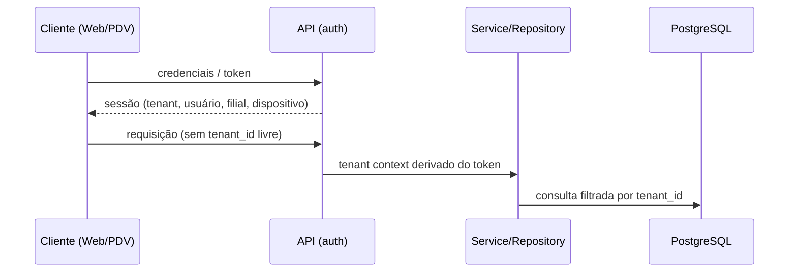

# Segurança

## Diretrizes gerais
- Nenhum secret no código (AWS Secrets Manager em produção). Nenhuma senha de PostgreSQL no git, nos scripts, nos testes ou na documentação.
- Dados fiscais, pagamentos e auditoria são imutáveis fisicamente.

## Isolamento de tenant
1. **Contexto autenticado:** o tenant é derivado da autenticação (usuário/dispositivo), nunca de input livre do frontend. Vale também para clientes offline/Edge: o tenant vem da credencial do dispositivo/sessão.
2. **Aplicação (camada 1, fundação no M2.1):** repository/service obtêm o tenant de `TenantContextService` e o incluem em toda query via `TenantScope` (`tenant_id + id`, nunca só `id`); sem contexto, falham com `TenantContextMissingError` antes de consultar o banco ([architecture.md](architecture.md)). Sem RLS, o banco garante escrita e relacionamentos dentro do tenant, mas **não** impede `erp_app` de ler ou enumerar linhas de outro tenant: o isolamento de leitura depende desta camada. `TenantContext` representa um contexto **já resolvido e confiável**; não autentica ninguém. Em runtime, só o AuthGuard o preenche (M2.7), a partir do access token verificado e da sessão ativa no banco; testes e infraestrutura chamam `run()` diretamente. Nunca preencher a partir de header, body, query string ou parâmetro do cliente (`X-Tenant-Id` não é identidade).
3. **Banco:** `tenant_id` obrigatório e constraints reforçando o isolamento quando possível. Relações cross-tenant devem ser **impossíveis no banco** sempre que viável (FK composta incluindo `tenant_id`, ver [database.md](database.md)); FKs organizacionais nunca usam cascade.
   - **`tenant_id` é imutável no banco** para toda entidade editável pertencente a tenant (decisão fechada, M1.14.1): trigger `BEFORE UPDATE OF tenant_id` por tabela, com a função compartilhada `forbid_tenant_id_change()`, rejeita (SQLSTATE `23000`) qualquer mudança real de `tenant_id`, via Prisma ou SQL, mesmo quando as FKs mudam juntas de forma consistente. Updates que não mudam o valor seguem livres. `audit_logs` usa política própria (append-only). Toda nova tabela de tenant precisa do trigger; a auditoria do catálogo falha sem ele. `erp_app` não consegue desabilitar nem alterar o trigger ou a função (M1.14.2b); o dono e a identidade admin conseguem.
   - **Identidades do banco separadas (M1.14.2b):** a aplicação e os workers conectam como `erp_app`, que não é dona de nenhum objeto, não é membro de `erp_migrator`, não cria objetos e tem só a matriz explícita de privilégios ([database.md](database.md)); migrations e seed rodam como `erp_migrator`, dono dos objetos, nunca usado em runtime; a identidade admin (superusuário ou master do RDS) só provisiona roles/banco e nunca é `DATABASE_URL` da aplicação. Roles não fazem parte das Prisma migrations (`infrastructure/postgres/`).
   - **Camadas hoje:** (1) TenantContext + queries scoped na aplicação (leitura e escrita); (2) FKs compostas, constraints e triggers do PostgreSQL (integridade de escrita, independente da aplicação). Futuro: RLS como defesa adicional de leitura.
4. **RLS (fase posterior):** segunda camada de proteção; **não ativa** hoje. Mecanismo de transmissão do tenant à sessão do banco e interação com pool de conexões/Prisma: **TBD**.
5. **Testes:** testes de isolamento multi-tenant obrigatórios ([testing-strategy.md](testing-strategy.md)).

## Fluxo de contexto (conceitual)


## Autenticação, autorização e dispositivos (M2 — encerrado)
Implementação em `apps/api/src/auth/`, `apps/api/src/authorization/`, `apps/api/src/tenants/` e `apps/api/src/users/employee-number.ts`. As regras de produto abaixo foram decididas no fechamento do M2; o que continua futuro está em [open-questions.md](open-questions.md). Autenticação das identidades do PostgreSQL em produção (Secrets Manager ou IAM database authentication): **futuro**.

### Fluxo
```mermaid
sequenceDiagram
  participant W as Web/PDV (access token em memória)
  participant A as API /auth
  participant G as AuthGuard (global)
  participant D as PostgreSQL (erp_app)
  W->>A: POST /auth/login {loginCode, employeeNumber, password}
  A->>D: tenant por login_code; usuário/senha com TenantScope
  A-->>W: {accessToken} + Set-Cookie refresh (HttpOnly, SameSite=Strict, Path=/auth)
  W->>G: Authorization: Bearer <access>
  G->>D: sessão no tenant do TOKEN: ativa? usuário ACTIVE? dispositivo/tenant permitidos?
  W->>A: POST /auth/refresh (cookie) -> novo access + novo cookie
  W->>A: POST /auth/logout (cookie) -> sessão revogada + cookie limpo
```

### Endpoints HTTP
| Endpoint | Autenticação | Função |
|---|---|---|
| `POST /auth/login` | pública + checagem de `Origin` | `{ loginCode, employeeNumber, password, deviceKey? }` → `{ accessToken, tokenType, accessTokenExpiresAt, sessionExpiresAt, mustChangePassword }` + cookie do refresh |
| `POST /auth/refresh` | pública + `Origin`; refresh token **só do cookie** | rotação; novo access token + novo cookie; falha = 401 + cookie limpo |
| `POST /auth/logout` | pública + `Origin`; cookie | revoga a sessão do cookie (se for o token atual), limpa o cookie, sempre 204 |
| `POST /auth/password` | Bearer | troca da própria senha (aceita com `must_change_password`) |
| `GET /health` | pública | liveness |

Não existem endpoints administrativos (reset de senha, LOCKED/unlock, revogação de dispositivo): os serviços existem e os endpoints são **futuros**, protegidos por permissão (ex.: `user.manage`).

### Descoberta do tenant: código público de login
- `tenants.login_code` (migration `20261012000000_add_tenant_login_code`): **código público, não é segredo**, único globalmente, formato `^[A-Z0-9][A-Z0-9-]{2,30}[A-Z0-9]$` (CHECK no banco). Normalização na aplicação (`normalizeLoginCode`): trim + uppercase, validado como ASCII antes do uppercase. Nulo = tenant ainda sem login por código.
- `LoginCodeTenantResolver` (implementação de `LoginTenantResolver`) só identifica o tenant; nunca autentica nem autoriza. Depois dele valem todas as regras do login. Código inexistente/inválido = a mesma falha genérica (401 `invalid_credentials`) com a verificação Argon2id equivalente. Nunca existe `X-Tenant-Id`, slug, subdomínio ou `tenantId` livre.
- Nome `login_code` (e não `organization_code`): no domínio, "organization" já designa os dados da Company (`organization.read`/`organization.manage`).
- Como o código é público, enumeração de códigos existe por natureza; mitigação = rate limiting distribuído (**futuro**, obrigatório antes de exposição em escala na internet).

### Senhas (Argon2id)
- `PasswordHasher` é o único ponto que gera/verifica senha: **somente Argon2id** (`argon2`), parâmetros centrais `ARGON2ID_PARAMS` (m = 19 MiB, t = 2, p = 1, baseline mínimo OWASP; revisar com benchmark no alvo de produção — o rehash no login migra hashes existentes), salt da biblioteca, hash PHC autocontido.
- Entrada limitada a 1 KiB antes de qualquer hash (DoS); hash armazenado inválido = falha genérica.
- Senha nova (troca/reset): tamanho mínimo `password.minLength` = 8 (**default técnico ainda pendente de decisão**); sem regra de complexidade.
- Senha, senha temporária e hash nunca vão para log, erro, resposta ou AuditLog.

### Matrícula (employee number)
- Decisão: trim + uppercase, **zeros à esquerda preservados** (`"007"` ≠ `"7"`), somente `[A-Z0-9._-]`, 1–32 caracteres. Mesma função (`normalizeEmployeeNumber`) para cadastro, login e comparações; entrada validada como ASCII antes do uppercase (mapeamentos Unicode como `ı`→`I` não geram matrícula válida).
- O banco impõe o formato: `users_employee_number_check` = `^[A-Z0-9._-]{1,32}$` (migration `20261012010000_enforce_employee_number_format`, que normalizou os dados existentes e aborta explicitamente em colisão ou valor inválido). Matrícula continua única **por tenant**.

### Login e erros
- Ordem fixa: tenant (código) → status do tenant → dispositivo declarado → usuário → bloqueios → senha.
- Falhas de credencial são **sempre genéricas** externamente (401 `invalid_credentials`): matrícula inexistente, senha errada, `DISABLED`, `LOCKED` e `locked_until` são indistinguíveis; a causa segura fica só no AuditLog. Verificação Argon2id equivalente quando não há senha a verificar.
- Sucesso, numa transação: zera contador e `locked_until`, grava `last_login_at` (e o rehash), cria a Session e registra `auth.login.succeeded`. `must_change_password` é devolvido e imposto pelo AuthGuard.

### Status do tenant
Aplicado no login, no refresh e em cada request (`tenantAllowsAuthentication`):

| Status | Autentica? |
|---|---|
| `ACTIVE` | sim |
| `TRIAL` | sim enquanto `trial_ends_at` for nulo ou futuro; expirado = não |
| `PAST_DUE` | sim (o billing decidirá quando passar a `SUSPENDED`) |
| `SUSPENDED`, `CANCELLED` | não |

Bloqueado = 403 `tenant_unavailable`. Sem modo somente leitura.

### Usuário: status e lockout
- `DISABLED` (desativação administrativa) e `LOCKED` (**bloqueio administrativo manual**, sem prazo) nunca autenticam, não renovam sessão e derrubam sessões no request seguinte. **O Auth nunca altera `status`**; LOCKED/unlock serão responsabilidade de endpoint administrativo futuro.
- **Lockout temporário:** 5 senhas erradas → `locked_until = agora + 15 min`, contador zerado, `status` inalterado (`AUTH_SECURITY_POLICY.lockout`, configurável). Incremento atômico no PostgreSQL (sem lost update; vale para todas as instâncias). Durante o bloqueio a senha não é verificada e nada é contado. Bloqueio temporário não derruba sessões existentes. Senha atual errada na troca também conta (`auth.password.change_failed`).
- **Lockout por conta ≠ rate limiting** por IP/dispositivo/distribuído: este é **futuro** (gateway/WAF/Redis).

### Access token
- JWT HS256 (`jose`), `typ: at+jwt`, `iss`/`aud` = `erp-api`. Claims mínimas: `sub`, `tid`, `sid`, `did` (se houver), `jti`, `iat`, `exp`; nada de permissões ou dados sensíveis. Só HS256 é aceito.
- TTL **15 min** (configurável). Devolvido no corpo; o frontend o mantém **em memória** e envia como `Authorization: Bearer`. Nunca persistido no servidor.
- O AuthGuard consulta a sessão a cada request (3 statements; 4 com dispositivo): revogação imediata, sem cache.

### Refresh token, cookie e sessão
- Formato `rt1.<tenantId>.<sessionId>.<secret>.<proof>`: `secret` de 256 bits; `proof` = HMAC-SHA256(K, `rt1|tenantId|sessionId|secret`), K derivada do `AUTH_ACCESS_TOKEN_SECRET` por HKDF com rótulo próprio. O banco guarda só `sha256$...` do segredo. Prova inválida = rejeitado **antes de qualquer acesso ao banco**, nada revogado: conhecer `tenantId`+`sessionId` não permite revogar sessão alheia.
- **Cookie** `__Secure-erp_rt` (sem prefixo e sem `Secure` só fora de produção, via `AUTH_COOKIE_SECURE=false`): `HttpOnly`, `Secure`, `SameSite=Strict`, `Path=/auth`, host-only (sem `Domain`), `Max-Age` = vida restante da sessão. Nunca no corpo nem em `localStorage`. Cookie repetido no header = ambíguo = recusado.
- **CSRF/origem** (login, refresh, logout): `Origin` deve estar na allowlist exata `AUTH_ALLOWED_ORIGINS` (obrigatória e https em produção); `Origin: null` e `Sec-Fetch-Site: cross-site/same-site` sem `Origin` são recusados (403 `forbidden_origin`); clientes não-navegador (sem `Origin` nem fetch metadata) passam, pois não estão sujeitos a CSRF. Somado ao `SameSite=Strict`. Sem CORS habilitado (arquitetura same-site).
- **Sessão:** 12 h **absolutas**, sem sliding (configurável). Rotação por UPDATE condicional (no máximo uma vence); token emitido mas já rotacionado = replay → sessão revogada (`auth.refresh.replay_detected`). Clientes devem serializar o refresh.
- **Logout** (`POST /auth/logout`): revoga a sessão do cookie quando é o token atual (token forjado = nada; token rotacionado = replay), sempre limpa o cookie. Revogação/logout nunca apagam a sessão (`revoked_at`). Retenção/LGPD de sessões: **futuro**.

### AuthGuard, AuthContext e TenantContext
- `AuthGuard` global, deny by default; `@Public()` só em método (marca de classe/herança ignorada). Mais de um `Authorization` nunca autentica. Tenant sempre do token verificado; sessão, usuário, dispositivo e tenant validados a cada request.
- `AuthContext = { tenantId, userId, sessionId, deviceId, mustChangePassword }`, separado do `TenantContext`; ambos abertos pelo `AuthContextInterceptor` só durante o handler (testado sob concorrência, transações e erros).
- `must_change_password`: 403 `password_change_required`, exceto rotas `@AllowWhenPasswordChangeRequired()`.
- Erros: só `{ "error": "<código>" }`; 401 = não autenticado, 403 = autenticado sem permissão / tenant indisponível / dispositivo / origem.

### Dispositivos
`device_key` é identificador, **não segredo**. Dispositivo declarado no login precisa ser do mesmo tenant e `ACTIVE`; `INACTIVE` e `REVOKED` bloqueiam login, refresh e requests. Pairing/autenticação de dispositivo: **futuro**.

### Autorização
- `AuthorizationService` resolve a cada chamada (sem cache, nada no JWT): só usuário `ACTIVE` + role `ACTIVE`, no tenant atual.
- **Escopo:** `tenant` = só roles tenant-wide. `branch` = roles tenant-wide + roles da filial, **somente com `UserBranchAccess` àquela filial** (role = O QUE; acesso = ONDE), mesmo para role tenant-wide.
- `@RequirePermissions(...)` / `@RequireBranchPermissions("branchId", ...)`: todas as permissões exigidas; classe e método valem juntos; código inexistente nunca concede; 401 sem autenticação, 403 sem permissão. Controllers usam códigos de permissão, nunca nomes de role.

### Roles padrão e matriz
`TenantProvisioningService.provisionDefaultRoles()` (idempotente, seguro sob concorrência, nunca assume role customizada) aplica `DEFAULT_ROLE_PERMISSIONS`:

| Permissão | OWNER | MANAGER | ATTENDANT | KITCHEN |
|---|:-:|:-:|:-:|:-:|
| organization.read | ✓ | ✓ | | |
| organization.manage | ✓ | | | |
| branch.read | ✓ | ✓ | ✓ | |
| branch.manage | ✓ | | | |
| user.read | ✓ | ✓ | | |
| user.manage | ✓ | ✓ | | |
| role.read | ✓ | ✓ | | |
| role.manage | ✓ | | | |
| product.read | ✓ | ✓ | ✓ | ✓ |
| product.manage | ✓ | ✓ | | |
| order.read | ✓ | ✓ | ✓ | ✓ |
| order.create | ✓ | ✓ | ✓ | |
| order.cancel | ✓ | ✓ | | |
| cash.read | ✓ | ✓ | ✓ | |
| cash.open | ✓ | ✓ | ✓ | |
| cash.close | ✓ | ✓ | | |
| fiscal.read | ✓ | ✓ | ✓ | |
| fiscal.issue | ✓ | ✓ | ✓ | |
| fiscal.cancel | ✓ | ✓ | | |

- OWNER recebe as 19 permissões **atuais**, listadas explicitamente; **não** recebe permissões futuras automaticamente. Toda permissão nova do catálogo deve ser adicionada explicitamente à matriz (um teste falha enquanto ela não estiver em nenhuma role).
- **Regra futura de administração:** um usuário não pode conceder role/permissão com autoridade superior à sua própria (ex.: MANAGER tem `user.manage`, mas não pode atribuir OWNER nem role com permissão que ele não tem). Será imposta quando houver endpoints administrativos.

### Troca e reset de senha
- `POST /auth/password`: exige a senha atual, grava o novo hash, limpa `must_change_password` e revoga as demais sessões.
- `PasswordService.resetPassword` (sem endpoint): senha temporária só como hash, `must_change_password = true`, lockout zerado, todas as sessões do alvo revogadas; não muda `DISABLED`/`LOCKED`. Geração/entrega da senha temporária é externa. Sem recuperação por e-mail.

**Acesso a filiais (`UserBranchAccess`) é separado de papel/permissão** e só existe dentro do mesmo tenant (FKs compostas); role por filial exige o vínculo. **Permission é um catálogo global** controlado pelo seed; o que varia por tenant é a atribuição via `RolePermission`.

## Auditoria
Módulo `audit`; registros não apagáveis fisicamente. Escopo geral dos eventos auditados: **TBD**; os eventos de segurança do Auth já são gravados (abaixo).

**Eventos de segurança do Auth (M2)** via `SecurityAuditWriter` (`apps/api/src/audit/security-audit.ts`), na mesma transação da operação quando há uma: `auth.login.succeeded`, `auth.login.failed` (`reason`), `auth.password.change_failed` (senha atual errada na troca; conta para o lockout), `auth.lockout.triggered` (`locked_until`), `auth.session.revoked` (`reason`), `auth.sessions.revoked` (`reason`, `count`), `auth.refresh.replay_detected`, `auth.password.changed`, `auth.password.reset` (ator em `user_id`, alvo em `resource_id`). Cada evento é um tipo fechado; `metadata` só aceita a allowlist `reason`, `count`, `locked_until` com valores enumerados/inteiros (metadata não-objeto também falha) (qualquer outra chave falha). **Nunca** gravados: senha, matrícula digitada (pode ser uma senha no campo errado), access/refresh token, `password_hash`, `refresh_token_hash`, objeto de request/DTO. Falha de login com matrícula inexistente grava `user_id NULL`. Risco: cada tentativa falha gera uma linha (amplificação de escrita sob ataque). Mitigação possível sem perder auditabilidade, ainda não implementada: agregar falhas de matrícula inexistente por janela. **Rate limiting distribuído (por IP/dispositivo, no gateway/WAF) é obrigatório antes de expor o login à internet**; não bloqueia desenvolvimento/MVP sem endpoint público.

**AuditLog** ([database.md](database.md)) é a estrutura persistente da trilha: por tenant, com usuário, filial e dispositivo opcionais (do mesmo tenant quando presentes, garantido por FKs compostas). Eventos sem usuário (workers, rotinas, sistema, só dispositivo) usam `user_id NULL`; não existe usuário fictício `SYSTEM`. `action` e `resource_type` são identificadores técnicos validados por CHECK de formato, sem enum; `resource_id` é referência lógica sem FK, para que o log sobreviva ao recurso. Só o Auth grava eventos (M2); instrumentação dos demais módulos e um `AuditService` geral são etapas futuras.

- **Append-only imposto pelo PostgreSQL:** os triggers `audit_logs_append_only` (UPDATE/DELETE, por linha) e `audit_logs_no_truncate` (TRUNCATE, por statement), ambos com a função `forbid_audit_log_mutation()` específica desta tabela, rejeitam fisicamente todo `UPDATE`, `DELETE` e `TRUNCATE` (inclusive TRUNCATE em cascata a partir de tabela pai), vindos do Prisma, de SQL direto ou de qualquer ferramenta. Só `INSERT` é permitido; correção de um evento = novo evento. É distinto do trigger genérico de `tenant_id` (M1.14.1), que `audit_logs` não usa.
- **Duas camadas independentes (M1.14.2b):** `erp_app` só tem `SELECT, INSERT` em `audit_logs` (UPDATE/DELETE/TRUNCATE negados por privilégio, `42501`) e, além disso, os triggers append-only rejeitam essas operações para qualquer identidade com privilégio de escrita. `erp_app` não executa as funções de proteção diretamente, não as altera, não desabilita/remove/cria triggers, não executa DDL e não consegue `SET session_replication_role = replica`.
- **Fronteira:** o dono dos objetos (`erp_migrator`) e a identidade admin ainda podem desabilitar triggers, alterar funções e executar DDL destrutivo; a mitigação é operacional (credenciais restritas ao pipeline de deploy e ao provisionamento, nunca à aplicação). Auditoria de ações do próprio pipeline/admin e mecanismo de autenticação em produção: TBD.
- **`metadata` (jsonb) nunca guarda credenciais nem segredos:** senha, `password_hash`, refresh/access token, `refresh_token_hash`, API key, segredo, chave privada, PIN, dados completos de cartão. Não há sanitizador automático nem verificação de conteúdo no banco; a auditoria de credenciais do catálogo checa só nomes de colunas. O `SecurityAuditWriter` do Auth já usa allowlist; o futuro `AuditService` geral deve seguir o mesmo padrão.
- `ip_address` e `metadata` podem conter dado pessoal: retenção e LGPD pendentes (#9).

## Automação externa
n8n e integrações só alteram dados críticos via API autenticada; nunca por acesso direto ao banco.

## Privacidade/LGPD
A imutabilidade física de vendas, pagamentos, fiscal e auditoria precisa ser conciliada com pedidos de eliminação de dados pessoais: **TBD — validação jurídica**.
