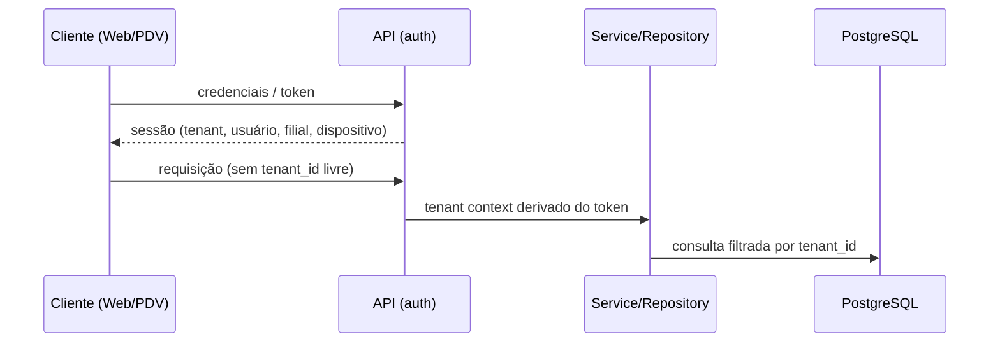

# Segurança

## Diretrizes gerais
- Nenhum secret no código (AWS Secrets Manager em produção).
- Dados fiscais, pagamentos e auditoria são imutáveis fisicamente.

## Isolamento de tenant
1. **Contexto autenticado:** o tenant é derivado da autenticação (usuário/dispositivo), nunca de input livre do frontend. Vale também para clientes offline/Edge: o tenant vem da credencial do dispositivo/sessão.
2. **Aplicação:** repository/service exigem tenant context; acesso sem contexto deve falhar.
3. **Banco:** `tenant_id` obrigatório e constraints reforçando o isolamento quando possível.
4. **RLS (fase posterior):** segunda camada de proteção; **não ativa** hoje. Mecanismo de transmissão do tenant à sessão do banco e interação com pool de conexões/Prisma: **TBD**.
5. **Testes:** testes de isolamento multi-tenant obrigatórios ([testing-strategy.md](testing-strategy.md)).

## Fluxo de contexto (conceitual)

## Autenticação, autorização e dispositivos
Módulos `auth`, `roles`, `permissions`, `devices` (ver [architecture.md](architecture.md)). Mecanismo de autenticação, política de sessão, expiração offline e modelo de permissões: **TBD**.

## Auditoria
Módulo `audit`; registros não apagáveis fisicamente. Escopo dos eventos auditados: **TBD**.

## Automação externa
n8n e integrações só alteram dados críticos via API autenticada; nunca por acesso direto ao banco.

## Privacidade/LGPD
A imutabilidade física de vendas, pagamentos, fiscal e auditoria precisa ser conciliada com pedidos de eliminação de dados pessoais: **TBD — validação jurídica**.
